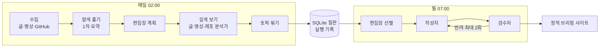

# TrendsIT

> 글, 유튜브 발표 영상, GitHub 트렌드를 매주 모아 **출처가 달린 기술 동향 브리핑**을 만드는 개인용 AI 에이전트. 매주 여러 곳을 돌며 확인하던 시간을 한 페이지로 줄인다.

[](https://github.com/jjiisub/trendsit/actions/workflows/ci.yml)
[예시 사이트](https://trendsit.jiseop.com) · 위키(준비 중) · [프로젝트 맥락](docs/CONTEXT.md)

> 현재 상태(2026-10-07): **S0 바탕 완료.** LLM 실행 기반, 비용·예산 장치, 실행 기록, 평가 틀이 동작한다. 수집(S1)부터 차례로 붙인다. 예시 사이트는 예시 데이터로 만든 화면이다.

## 1. 왜 만들었나
- 개발자로 일하며 새 기술을 따라가려면 블로그, 뉴스, 발표 영상, GitHub를 매주 따로 돌아야 했다(주 3시간 안팎)
- 글 요약, 영상 요약, GitHub 트렌딩 도구는 각각 있지만, **같은 주제의 글·영상·레포를 한데 묶고 출처까지 대조해 주는 도구**는 없었다
- 접근: 판단이 필요한 곳에만 LLM을 쓰는 역할(에이전트)들을 파이썬 코어 하나로 엮고, 모든 문장에 근거 링크를 붙인다. 목표는 주 3시간 → 15분

## 2. 핵심 기능
| 기능 | 내용 | 상태 |
|---|---|---|
| 멀티모달 수집 ★ | 글 6곳 + 유튜브 발표 영상(음성 전사 + 슬라이드 판독) + GitHub 주간 트렌딩 | 수집·백필 **S1 완료**, 영상 분석 S4 |
| 원본 추적 ★ | 큐레이션 글이 가리키는 1차 자료(논문, 공식 글, 레포)까지 링크를 따라가 대조 | S3 |
| 소스 간 교차 연계 ★ | 같은 주제의 글, 영상, 레포를 한 토픽으로 묶어 연결 서술 | S5 |
| 근거 검수 | 작성자 ⇄ 검수자 루프. 근거와 맞지 않는 문장은 반려하거나 '확인 필요'로 표시 | S5 |
| 비용·품질 관리 | 호출마다 실제 청구액 기록, 예산 상한, 응답 캐시, 역할별 자동 평가 | **S0 완료** |

★ 차별점. 상세는 [docs/CONTEXT.md](docs/CONTEXT.md) 5장.

## 3. 아키텍처
<!-- 그림 파일을 넣으면 docs/images/architecture.png로 교체 -->


- 역할끼리 직접 대화하지 않고 산출물을 SQLite(칠판)에 쓰고 읽는다. 흐름은 코드, LLM은 판단 지점만
- 역할 하나 = `roles/<이름>.md` 하나(앞부분 실행 설정 + 본문 지시). 도구, 출력 스키마, 상한, 보안은 파이썬 코드

| 역할 | 입력 → 출력 | 형태 | 스펙 |
|---|---|---|---|
| 레포 한 줄 설명 (`repo_oneliner`) | README 앞부분 → 레포가 하는 일 한 문장 | LLM 1회 | **S0 완료** |
| 글 1차 요약 | 원글 본문 → 요약, 핵심 주장, 수치, 원본 확인 필요 여부 | LLM 1회 | S2 |
| 편집장 · 계획 | 그날 후보 전체 → 항목별 깊게 볼지, 최대 깊이 | 판단 + 코드 분기 | S3 |
| 글 분석가 | 글 + 링크 → 원본, 추적 경로, 원본과의 차이 | 도구 에이전트 | S3 |
| 레포 분석가 | 트렌딩 수치 + README → 하는 일, 신호, 과열 신호 | 도구 에이전트 | S3 |
| 영상 분석가 | 전사 + 슬라이드 프레임 → 슬라이드 전용 수치, 타임라인 | 판단 + 코드 분기 | S4 |
| 편집장 · 선별 / 작성자 / 검수자 | 토픽 후보 → 순위 → 토픽 페이지 → 판정 | LLM 1회 | S5 |

모델 별칭은 `config/models.yaml`: 생성 `generate`(qwen3.8-27b, 오픈웨이트), 채점 `judge`(gemini-3.8-flash, 다른 계열), 배관 확인 `smoke`(무료 모델). 9주차 이후 로컬(Ollama)로 옮길 때 설정만 바꾼다.

## 4. 빠른 시작
```bash
uv sync                                        # 파이썬 3.12 + 의존성
export OPENROUTER_API_KEY=...                  # 또는 ~/.config/trendsit/.env (변수 이름은 .env.example)
uv run python -m trendsit check-config         # 설정과 역할 정의 검증
uv run python -m trendsit role repo_oneliner --input eval/fixtures/repo_oneliner/ollama__ollama.json
uv run python -m trendsit collect --since 2026-09-28 --until 2026-10-04   # 기간 수집(RSS가 짧으면 백필)
uv run python -m trendsit report collection --since 2026-09-28 --until 2026-10-04
uv run python -m trendsit cost --spec S0       # 사용액과 남은 예산
```
그 밖의 명령: 수집 항목 보기 `items [--week 2026-W40] [--status pass]`, 기록된 호출 다시 실행 `role --replay <step_id> [--model 별칭]`, 평가 `eval <역할> [--model 별칭]`, 실행 기록 보기 `trace <run_id>`. 전체 명령표와 동작 방식은 [docs/DEVELOPMENT.md](docs/DEVELOPMENT.md).

## 5. 사용 예시 / 결과물
- 지금 나오는 것: 레포 한 줄 설명. 예) `encode/httpx` → "Python용 동기·비동기 API와 HTTP/2 지원, 내장 CLI를 갖춘 HTTP 클라이언트 라이브러리"
- 최종 결과물(주간 브리핑)의 모습은 [예시 사이트](https://trendsit.jiseop.com)에서 볼 수 있다(예시 데이터). 실제 브리핑은 S5 이후

## 6. 성과와 평가
스펙마다 갱신한다. 품질은 `eval`의 코드 채점 + LLM 채점(judge), 비용은 `cost` 기준.

| 스펙 | 대상 | 품질 | 비용 |
|---|---|---|---|
| S0 | `repo_oneliner` 픽스처 10개(generate) | 코드 채점 10/10, 정확성 평균 4.8 / 5(1점 0개), 구체성 4.9, 표현 5.0 | S0 전체 $0.052 (상한 $0.15) |
| S0 | `lookup_agent` 도구 루프 5건(smoke) | 5/5. 깊이 상한 밖 문서는 코드가 거부 | $0 |
| S1 | 수집 9/28~10/4(한 주) | 글 491건(GeekNews 376, AI타임스 79, OpenAI 15, Simon Willison 17, Anthropic 2, DeepMind 2), 영상 17편, 릴리스 18건, 트렌딩 11개. 6곳 모두 기간을 덮음(백필 GeekNews·AI타임스·유튜브), 중복 0. 본문 추출 성공 GeekNews 77%(사이트의 브라우저 확인으로 토픽 페이지가 막혀 원문 글로 대체), 나머지 글 소스 93~100%. 키워드 통과 207건 | LLM 없음 $0 |
| S1 | `repo_oneliner` 새 프롬프트 형식 + 예/아니오 채점(generate) | 코드 채점 8/10(근거 구절 검사에서 2건 실패), judge 판정 Q1·Q2·Q3 8/8(잠정, 사람 라벨 전) | S1 $0.035 (상한 $0.05) |

- 같은 입력 재실행은 캐시로 0원. 채점 기준은 S1부터 예/아니오 질문 + 사람 라벨 일치율로 바뀐다
- 상세: [reports/S0_quality.md](reports/S0_quality.md), [reports/S0_report.md](reports/S0_report.md), [reports/S1_collection.md](reports/S1_collection.md), [reports/S1_report.md](reports/S1_report.md)

## 7. 기술적 도전
| 문제 | 시도 | 해결 | 결과 |
|---|---|---|---|
| 예산을 키 사용량으로 지키려 했는데 OpenRouter 키 usage가 몇 분 늦게 반영됨 | 호출마다 응답의 `usage.cost` 기록 | 단계 사용액 = max(키 usage − 기준값, 실행 기록 합) | 늦은 값으로 예산을 적게 보는 일 없음. 기록 합과 실제 청구액 일치 확인 |
| 도구 에이전트가 `parent=null`로 깊은 문서를 바로 읽어 깊이 상한을 우회할 수 있음 | 모델이 준 parent로 깊이 계산 | 실제로 읽은 문서에 그 링크가 있을 때만 이어진 것으로 셈 | 우회 테스트 통과. S3 원본 추적이 그대로 씀 |
| 무료 모델이 구조화 출력을 지원하지 않거나 길이 조건을 자주 어김 | strict JSON 스키마에 길이 조건 포함 | 길이 등은 pydantic 검증(코드)이 지키고, 실패하면 오류를 알려 주고 재시도(최대 2회) | 제공사와 무관하게 같은 스키마로 동작 |

자세한 과정은 위키(준비 중)와 [reports/S0_report.md](reports/S0_report.md).

## 8. 기술 스택
| 영역 | 선택 | 이유 |
|---|---|---|
| 언어, 도구 | Python 3.12, uv, ruff, pytest | 단일 코어, 빠른 설치와 재현 |
| LLM 호출 | 공식 `openai` SDK + pydantic, 에이전트 루프 직접 구현 | OpenAI 호환 `/v1` 하나로 OpenRouter와 로컬 Ollama를 같이 씀. 프레임워크 없이 실행 기록을 원하는 대로 |
| 모델 | qwen3.8-27b(생성), gemini-3.8-flash(채점) | 오픈웨이트로 시작해 로컬 전환, 채점은 다른 계열 |
| 저장 | SQLite(WAL) | 칠판 + 실행 기록 하나. 이후 sqlite-vec, FTS5 |
| 화면 | 정적 사이트(파이썬 표준 라이브러리 빌드) | 브리핑은 조회만. 홈서버 + Cloudflare Tunnel |

선택 이유의 기록(ADR)은 `docs/adr/`(S1 이후).

## 9. 폴더 구조
```
config/      설정: 모델 별칭(models), 예산(budget), 소스(sources), 키워드(keywords)
roles/       역할 정의 = 프롬프트 폴더. 앞부분 실행 설정 + 본문 지시
skills/      여러 역할이 같이 쓰는 지침(문체 등)
trendsit/    파이썬 패키지: cli, core(LLM 호출, 캐시, 예산, run_role/run_agent, 실행 기록), tools
eval/        평가: 픽스처, 채점표, 채점기, 채점자 역할
tests/       단위 테스트(LLM은 모의)
scripts/     관문 A 확인 스크립트(verify_s<n>.sh) 등
reports/     스펙별 리포트와 품질 리포트
docs/        CONTEXT(전체 맥락), handoff(스펙), reference(에이전트 명세 등)
site_src/    예시 사이트 빌드 코드
data/        실행 기록 DB, 캐시(git 제외), 예시 사이트 데이터(출력 계약)
```

## 10. 로드맵 / 한계
- [x] S0 바탕: LLM 호출, 비용·예산, 캐시, 실행 기록, 평가 틀
- [x] S1 수집: 글 6곳(RSS + 백필), 유튜브, GitHub 트렌딩, SSRF 방어
- [ ] S2 글 1차 요약 + 임베딩 필터
- [ ] S3 깊게 보기: 편집장 계획, 글 분석가(원본 추적), 레포 분석가
- [ ] S4 영상 분석가(전사 + 슬라이드 판독)
- [ ] S5 주간 브리핑: 묶기, 선별, 작성 ⇄ 검수
- [ ] S6 공개와 자동화: 사이트 연결, 매일·매주 자동 실행
- [ ] 9주차 이후: 로컬 모델 전환, 자연어 추적 관리, 쌓인 브리핑 Q&A

알려진 한계
- 지금은 클라우드 API(OpenRouter)로 개발 중. 로컬 운영은 모델 선정(9주차) 이후
- 소스와 키워드는 설정 파일에 고정(MVP). 화면에서 바꾸는 기능은 이후
- GitHub Trending 페이지는 과거 기록이 없어 그 주에 실행해야 함
- S0 채점은 변별력이 낮았음(대부분 5점). S1에서 예/아니오 질문과 사람 라벨로 바꿈

## 만든 사람
- jiseop · 서강대 "실전 AI 에이전트 시스템 설계·구축" 2026-2 학기 프로젝트
- 라이선스: 저장소를 공개할 때 정한다
