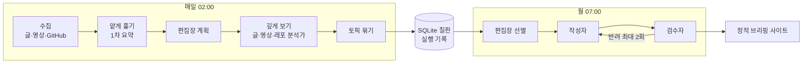

# TrendsIT

> 글, 유튜브 발표 영상, GitHub 트렌드를 매주 모아 **출처가 달린 기술 동향 브리핑**을 만드는 개인용 AI 에이전트. 매주 여러 곳을 돌며 확인하던 시간을 한 페이지로 줄인다.

[](https://github.com/jjiisub/trendsit/actions/workflows/ci.yml)
[예시 사이트](https://trendsit.jiseop.com) · 위키(준비 중) · [프로젝트 맥락](docs/CONTEXT.md)

> 현재 상태(2026-10-10): **S0~S5 구현 완료(S5 병합).** 글 6곳·유튜브·GitHub 트렌딩 수집, 글 1차 요약과 원본 추적, 레포 분석, 영상 전사와 슬라이드 판독까지 동작한다. 매일 02:00 수집이 돌고 있다. 주간 브리핑(묶기 → 편집장 선별 → 작성자 ⇄ 코드 검사·검수자 → 저장)은 `weekly` 명령으로 돈다. W40·W41 결과는 `reports/S5_brief/briefing_<주>.md`(읽기본)에서 볼 수 있고, 사이트 연결은 S6. **S5-1a 정리 반영**(예산 초과 시 멈춤·종료 코드 1, `read_more` 조회 열쇠, 효과 없는 설정 키·죽은 코드 삭제, 프롬프트·코드 검사 결과 불변, 리뷰 대기). **S5-1b 단순화 반영**(코드 검사 규칙을 넓고 자주 걸리는 것만 남기고 지엽 규칙은 역할 md로, 중복 코드·중복 md 문장 정리, 작성자 입력 `limits`, 긴 함수 쪼개기. 관문 B 재실행은 런 뒤). 예시 사이트는 예시 데이터로 만든 화면이다.

## 1. 왜 만들었나
- 개발자로 일하며 새 기술을 따라가려면 블로그, 뉴스, 발표 영상, GitHub를 매주 따로 돌아야 했다(주 3시간 안팎)
- 글 요약, 영상 요약, GitHub 트렌딩 도구는 각각 있지만, **같은 주제의 글·영상·레포를 한데 묶고 출처까지 대조해 주는 도구**는 없었다
- 접근: 판단이 필요한 곳에만 LLM을 쓰는 역할(에이전트)들을 파이썬 코어 하나로 엮고, 모든 문장에 근거 링크를 붙인다. 목표는 주 3시간 → 15분

## 2. 핵심 기능
| 기능 | 내용 | 상태 |
|---|---|---|
| 멀티모달 수집 ★ | 글 6곳 + 유튜브 발표 영상(음성 전사 + 슬라이드 판독) + GitHub 주간 트렌딩 | 수집·백필 **S1 완료**, 영상 분석가 **S4 완료**(로컬 전사, 슬라이드 전용 수치, 시각 링크 타임라인) |
| 원본 추적 ★ | 큐레이션 글이 가리키는 1차 자료(논문, 공식 글, 레포)까지 링크를 따라가 대조 | **S3 완료**(원본 확보 14/16) |
| 소스 간 교차 연계 ★ | 같은 주제의 글, 영상, 레포를 한 토픽으로 묶어 연결 서술 | **S5 완료**(리뷰 대기, 2채널 이상 토픽 1/20) |
| 근거 검수 | 작성자 ⇄ 검수자 루프. 근거와 맞지 않는 문장은 반려하거나 '확인 필요'로 표시 | **S5 완료**(리뷰 대기) |
| 비용·품질 관리 | 호출마다 실제 청구액 기록, 예산 상한, 응답 캐시, 역할별 자동 평가 | **S0 완료** |

★ 차별점. 상세는 [docs/CONTEXT.md](docs/CONTEXT.md) 5장.

## 3. 아키텍처
<!-- 그림 파일을 넣으면 docs/images/architecture.png로 교체 -->


- 역할끼리 직접 대화하지 않고 산출물을 SQLite(칠판)에 쓰고 읽는다. 흐름은 코드, LLM은 판단 지점만
- 역할 하나 = `roles/<이름>.md` 하나(앞부분 실행 설정 + 본문 지시). 도구, 출력 스키마, 상한, 보안은 파이썬 코드

| 역할 | 입력 → 출력 | 형태 | 스펙 |
|---|---|---|---|
| 레포 한 줄 설명 (`repo_oneliner`) | README 앞부분 → 레포가 하는 일 한 문장 | LLM 1회 | **S0 완료** |
| 글 1차 요약 (`item_card`) | 원글 본문 → 인용 근거가 달린 요약, 핵심 주장, 수치, 원본 확인 필요 여부 | LLM 1회 | **S2~S3 완료**(관문 B 잠정) |
| 편집장 · 계획 (`editor_plan`) | 그날 후보 전체 → 항목별 깊게 볼지, 최대 깊이 | 판단 + 코드 분기 | **S2~S3 완료**(관문 B 잠정) |
| 글 분석가 (`text_analyst`) | 글 + 링크 → 원본, 추적 경로, 원본과의 차이 | 도구 에이전트 | **S2~S3 완료**(관문 B 잠정) |
| 레포 분석가 (`repo_analyst`) | 트렌딩 수치 + README → 하는 일, 신호, 과열 신호 | 도구 에이전트 | **S2~S3 완료**(관문 B 잠정) |
| 영상 분석가 (`video_slide`, `video_summary`) | 영상 처리 지시 → 로컬 전사 + 슬라이드 판독 → 슬라이드 전용 수치, 표기 쌍, 타임라인, 요약 | 판단 + 코드 분기 | **S4 완료** |
| 편집장 · 선별 / 작성자 / 검수자 | 토픽 후보 → 순위 → 토픽 페이지 → 판정 | LLM 1회 | **S5 완료**(관문 B 잠정) |

모델 별칭은 `config/models.yaml`: 생성 `generate`(qwen3.8-27b, 오픈웨이트), 채점 `judge`(gemini-3.8-flash, 다른 계열), 배관 확인 `smoke`(무료 모델). 9주차 이후 로컬(Ollama)로 옮길 때 설정만 바꾼다.

## 4. 빠른 시작
```bash
uv sync                                        # 파이썬 3.12 + 의존성
export OPENROUTER_API_KEY=...                  # 또는 ~/.config/trendsit/.env (변수 이름은 .env.example)
uv run python -m trendsit check-config         # 설정과 역할 정의 검증
uv run python -m trendsit role repo_oneliner --input eval/fixtures/repo_oneliner/ollama__ollama.json
uv run python -m trendsit collect --since 2026-09-28 --until 2026-10-04   # 기간 수집(RSS가 짧으면 백필)
uv run python -m trendsit report collection --since 2026-09-28 --until 2026-10-04
uv run python -m trendsit rematch --since 2026-09-28 --until 2026-10-04   # 바뀐 키워드로 판정만 다시(수집 없음)
uv sync --extra embed                          # 임베딩 필터용(sentence-transformers, Qwen3-Embedding)
uv run python -m trendsit filter --since 2026-09-28 --until 2026-10-04 --report   # 관련성 keep/drop + 같은 URL 연결
uv run python -m trendsit summarize --since 2026-09-28 --until 2026-10-04 --spec S2   # 글 1차 요약 카드
uv run python -m trendsit repo-analyze --week 2026-W41 --traces   # 레포 분석가(규칙 기반 큐 또는 --queue)
uv run python -m trendsit plan --day 2026-10-04 --report          # 편집장 계획(plan show --day D --video-queue로 S4 입력)
uv run python -m trendsit deep text --day 2026-10-04 --traces     # 글 분석가: 계획의 원본 추적 큐
uv run python -m trendsit cluster --week 2026-W41 --spec S5      # 주간 묶기 + 과거 대조 → reports/S5_brief/cluster_<주>.md
uv run python -m trendsit weekly --week 2026-W41 --spec S5       # 주간 브리핑 끝까지 → 칠판 저장 + reports/S5_brief/briefing_<주>.md(읽기본)
uv run python -m trendsit weekly --week 2026-W41 --from-step write --topic w41-mistral-large-4   # 단계·토픽만 다시(새 run)
uv run python -m trendsit cost --spec S0       # 사용액과 남은 예산
```
영상 분석가(맥, Apple Silicon): `uv sync --extra video` 뒤
```bash
TRENDSIT_SPEC=S4 uv run --extra video python -m trendsit video run --video-id xRZHLI5SPWo --mode whisper+slides
TRENDSIT_SPEC=S4 uv run --extra video python -m trendsit video run --queue q.json   # 영상 처리 지시 배열
uv run python -m trendsit video purge --older-than 7                                # 영상·프레임 정리(DB 텍스트는 남음)
```
시스템 의존성(영상): ffmpeg·ffprobe(`brew install ffmpeg`), yt-dlp용 JS 런타임 deno·node·bun 중 하나(없으면 유튜브 영상 포맷이 403). 전사는 로컬 mlx-whisper(`large-v3-turbo`, 첫 실행 때 약 1.6GB 받음). 외부 전사 API와 유튜브 자동 자막은 쓰지 않는다. `uv run`은 선택 묶음을 지우므로 영상 명령은 `--extra video`를 붙인다.
그 밖의 명령: 수집 항목 보기 `items [--week 2026-W40] [--status pass]`, 기록된 호출 다시 실행 `role --replay <step_id> [--model 별칭]`, 평가 `eval <역할> [--model 별칭]`, 실행 기록 보기 `trace <run_id>`. 전체 명령표와 동작 방식은 [docs/DEVELOPMENT.md](docs/DEVELOPMENT.md).

## 5. 사용 예시 / 결과물
- 지금 나오는 것: 레포 한 줄 설명. 예) `encode/httpx` → "Python용 동기·비동기 API와 HTTP/2 지원, 내장 CLI를 갖춘 HTTP 클라이언트 라이브러리"
- 최종 결과물(주간 브리핑)의 모습은 [예시 사이트](https://trendsit.jiseop.com)에서 볼 수 있다(예시 데이터). 실제 브리핑은 S5 이후

## 6. 성과와 평가
스펙마다 갱신한다. 품질은 `eval`의 코드 채점 + LLM 채점(judge), 비용은 `cost` 기준.

| 스펙 | 대상 | 품질 | 비용 |
|---|---|---|---|
| S0 | `repo_oneliner` 픽스처 10개(generate) | 코드 채점 10/10, 정확성 평균 4.8 / 5(1점 0개), 구체성 4.9, 표현 5.0 | S0 전체 $0.052 (상한 $0.15) |
| S0 | `lookup_agent` 도구 루프 5건(smoke) | 5/5. 깊이 상한 밖 문서는 코드가 거부 | $0 |
| S1 | 수집 9/28~10/4(한 주) | 글 308건(AI타임스 188, GeekNews 83, Simon Willison 18, OpenAI 15, Anthropic 2, DeepMind 2), 영상 17편, 릴리스 18건, 트렌딩 11개(페이지 전부). 6곳 모두 기간을 덮음, 중복 0. 본문 추출 성공 GeekNews 98%(원문 기준, 의도적 건너뜀 제외), 나머지 93~100%. GeekNews는 날짜별 목록 날짜당 1페이지(점수 상위 약 20건, 자기 글 제외 하루 11.9건). 키워드 통과 184건 | LLM 없음 $0 |
| S2 | 임베딩 필터, `item_card` (클라우드 구현 + 맥 확인 + 리뷰 반영) | 관문 A 전부 통과. 한 주(9/28~10/4) 키워드 재판정 통과 305건, 임베딩 필터(MPS) keep 278 / drop 47(문턱값 잠정 0.30·0.50, 라벨 40건 keep 정밀도 68.4%·재현율 92.9%). 시드 11/13(85% 미달: 임베딩으로 고객 사례를 못 가름). item_card 관문 B 21건: 코드 20/21(미달 1), 인용 일치 108/108. 잠정(labeler opus-5.5): 모델 대 모델 일치율 Q1 47.6%(완화 85.7%)·Q2 100%·Q3 100%. 한 주 요약 264건(high 134 / mid 91 / low 39, 원본 확인 필요 158, 잘린 인용 4.1%) | 클라우드 $0.37 + 맥 $0.69 = $1.06 (상한 $1.50) |
| S3 | 편집장 계획, 글 분석가, 레포 분석가 (클라우드 구현 + 맥 확인 + 리뷰 반영) | 관문 A 통과. 관문 B 코드 채점: repo_analyst 2026-W41 10개 10/10(평균 도구 호출 3.4, GitHub 도구 오류율 0), editor_plan 3/3(실제 계획: 영상 17편 중 5편 whisper 84분, 글 5, 레포 4), text_analyst 16/16(근거 없는 판정 0, 부분 확인 내림 5 보고용, 원본 확보 14/16). 잠정(labeler opus-5.5): 모델 대 모델 일치율 repo_analyst 90·90·100%, editor_plan 33·100%, text_analyst 94·75·94%, 영상 mode 동의율 88.2% | 클라우드 $0.06 + 맥 $0.50 = $0.56 (상한 $2.00) |
| S1 | `repo_oneliner` 새 프롬프트 형식 + 예/아니오 채점(generate) | 3회 개선 후 코드 채점 8/10 → README 기호 정리(설계 결정) 뒤 코드 9/10, judge Q1·Q2·Q3 9/9(잠정, 사람 라벨 전). 남은 실패는 README가 한 줄뿐인 레포의 attention | S1 $0.056 (상한 $0.06) |
| S4 | 영상 분석가, Tech Bridge 10편(슬라이드 발표 7, 대담 3, 맥) | 1차 처리 10/10 성공·계약 검사 전부 통과, 로컬 전사 10~31분 영상당 1~2.5분(M1 Max GPU). 슬라이드 판독 139/140장, 슬라이드 전용 수치 124개. 잠정(labeler opus-5.5): 판독 수치 정확도 98.2%, 포착률 87.9%, 요약 Q1 67%·Q2 42%·Q3 75%(미달, S5에서 개선). 같은 전사에 슬라이드를 더하면 잘못 들은 수치가 화면 값으로 바로잡힘(예: 'Sweebench Pro 88%' → SWE-Bench Pro 80.3%) | S4 $0.52 (상한 $0.80) |
| S5 | 주간 브리핑: 근거 목록·별칭 → 묶기(decide)·과거 대조 → 편집장 선별 → 작성자 ⇄ 코드 검사·검수자(최대 3라운드), W40 + W41 실제 실행 | 관문 A A1~A14. PR 리뷰 네 차례(라벨 opus-5.5, 잠정) 반영. 20토픽 작성 실패 0, judge: 원자 사실 지지 18/20 토픽 100%, 핵심 포착 90%, 군더더기 90%, 읽기 쉬움·번역투 100%, 표현 선택 누락 1(통과), 코드 문체 위반 2. 반복 미달 토픽은 ⚠로 발행(C-24). decide 라벨 58/58·오병합 0, 정규화 17/17, 선별 검증(코드 정리 뒤) 2/2, 영상 자리 2/2. 실행 시간 OpenRouter 15~17분/주, 로컬 추정 94~115분(목표 90분 초과) | S5 $3.88 (상한 $6.00) |

- 같은 입력 재실행은 캐시로 0원. 채점 기준은 S1부터 예/아니오 질문 + 사람 라벨 일치율로 바뀐다
- 상세: [reports/S0_quality.md](reports/S0_quality.md), [reports/S0_report.md](reports/S0_report.md), [reports/S1_collection.md](reports/S1_collection.md), [reports/S1_report.md](reports/S1_report.md), [reports/S4_report.md](reports/S4_report.md), [reports/S4_video/](reports/S4_video/README.md)

## 7. 기술적 도전
| 문제 | 시도 | 해결 | 결과 |
|---|---|---|---|
| 예산을 키 사용량으로 지키려 했는데 OpenRouter 키 usage가 몇 분 늦게 반영됨 | 호출마다 응답의 `usage.cost` 기록 | 단계 사용액 = max(키 usage − 기준값, 실행 기록 합) | 늦은 값으로 예산을 적게 보는 일 없음. 기록 합과 실제 청구액 일치 확인 |
| 도구 에이전트가 `parent=null`로 깊은 문서를 바로 읽어 깊이 상한을 우회할 수 있음 | 모델이 준 parent로 깊이 계산 | 실제로 읽은 문서에 그 링크가 있을 때만 이어진 것으로 셈 | 우회 테스트 통과. S3 원본 추적이 그대로 씀 |
| 무료 모델이 구조화 출력을 지원하지 않거나 길이 조건을 자주 어김 | strict JSON 스키마에 길이 조건 포함 | 길이 등은 pydantic 검증(코드)이 지키고, 실패하면 오류를 알려 주고 재시도(최대 2회) | 제공사와 무관하게 같은 스키마로 동작 |

자세한 과정은 위키(준비 중)와 [reports/S0_report.md](reports/S0_report.md).

## 8. 기술 스택
| 영역 | 선택 | 이유 |
|---|---|---|
| 언어, 도구 | Python 3.12, uv, ruff, pytest | 단일 코어, 빠른 설치와 재현 |
| LLM 호출 | 공식 `openai` SDK + pydantic, 에이전트 루프 직접 구현 | OpenAI 호환 `/v1` 하나로 OpenRouter와 로컬 Ollama를 같이 씀. 프레임워크 없이 실행 기록을 원하는 대로 |
| 모델 | qwen3.8-27b(생성), gemini-3.8-flash(채점) | 오픈웨이트로 시작해 로컬 전환, 채점은 다른 계열 |
| 저장 | SQLite(WAL) | 칠판 + 실행 기록 하나. 이후 sqlite-vec, FTS5 |
| 화면 | 정적 사이트(파이썬 표준 라이브러리 빌드) | 브리핑은 조회만. 홈서버 + Cloudflare Tunnel |

선택 이유의 기록(ADR)은 `docs/adr/`(S1 이후).

## 9. 폴더 구조
```
config/      설정: 모델 별칭(models), 예산(budget), 소스(sources), 키워드(keywords)
roles/       역할 정의 = 프롬프트 폴더. 앞부분 실행 설정 + 본문 지시
skills/      여러 역할이 같이 쓰는 지침(문체 등)
trendsit/    파이썬 패키지: cli, core(LLM 호출, 캐시, 예산, run_role/run_agent, 실행 기록), tools, collect(수집), filter(재판정, 임베딩 필터, 중복 연결), deep(편집장 계획, 글 분석가, 레포 분석가)
             collect/video(영상 받기, 로컬 전사, 프레임), video(대조, 영상 분석가 파이프라인)  # S4
eval/        평가: 픽스처, 채점표, 채점기, 채점자 역할
tests/       단위 테스트(LLM은 모의)
scripts/     관문 A 확인 스크립트(verify_s<n>.sh) 등
reports/     스펙별 리포트와 품질 리포트
docs/        CONTEXT(전체 맥락), handoff(스펙), reference(에이전트 명세 등)
site_src/    예시 사이트 빌드 코드
data/        실행 기록 DB, 캐시(git 제외), 예시 사이트 데이터(출력 계약)
```

## 10. 로드맵 / 한계
- [x] S0 바탕: LLM 호출, 비용·예산, 캐시, 실행 기록, 평가 틀
- [x] S1 수집: 글 6곳(RSS + 백필), 유튜브, GitHub 트렌딩, SSRF 방어
- [x] S2 글 1차 요약 + 임베딩 필터
- [x] S3 깊게 보기: 편집장 계획, 글 분석가(원본 추적), 레포 분석가
- [x] S4 영상 분석가(로컬 전사 + 슬라이드 판독, 맥)
- [x] S5 주간 브리핑: 묶기, 선별, 작성 ⇄ 검수(관문 B 잠정, 근거 충실성 3토픽 미달)
- [ ] S6 공개와 자동화: 사이트 연결, 매일·매주 자동 실행
- [ ] 9주차 이후: 로컬 모델 전환, 자연어 추적 관리, 쌓인 브리핑 Q&A

알려진 한계
- 지금은 클라우드 API(OpenRouter)로 개발 중. 로컬 운영은 모델 선정(9주차) 이후
- 소스와 키워드는 설정 파일에 고정(MVP). 화면에서 바꾸는 기능은 이후
- GitHub Trending 페이지는 과거 기록이 없어 그 주에 실행해야 함
- S0 채점은 변별력이 낮았음(대부분 5점). S1에서 예/아니오 질문과 사람 라벨로 바꿈

## 만든 사람
- jiseop · 서강대 "실전 AI 에이전트 시스템 설계·구축" 2026-2 학기 프로젝트
- 라이선스: 저장소를 공개할 때 정한다
