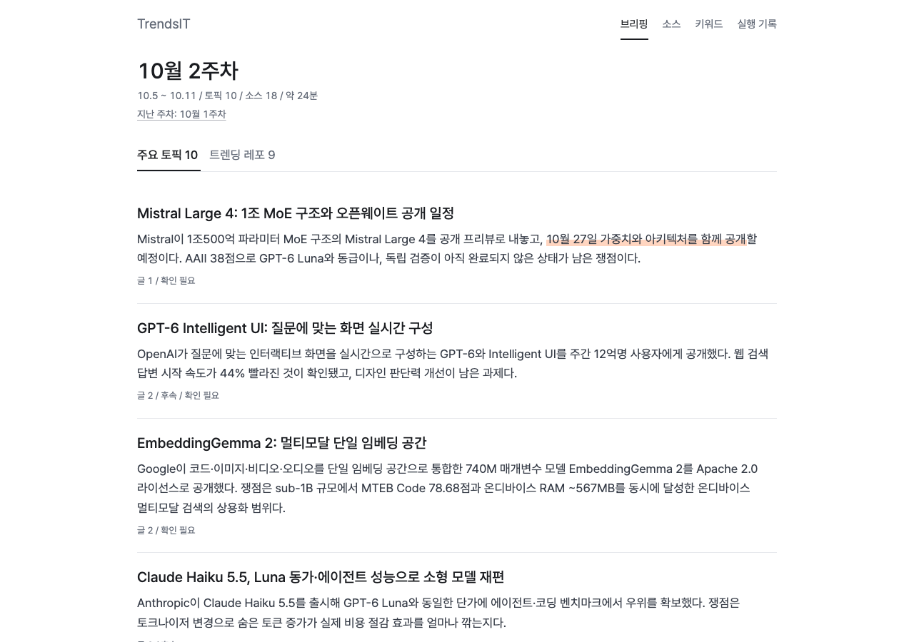
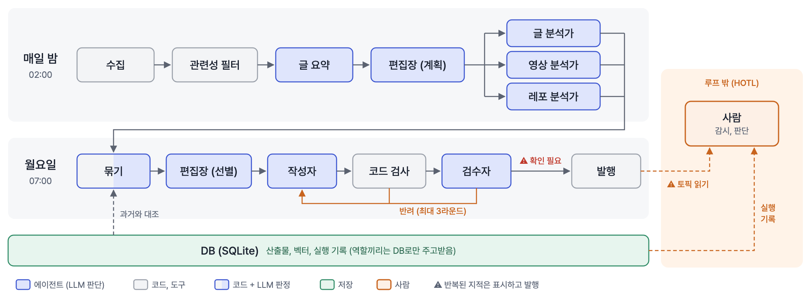

# TrendsIT

흩어진 기술 소식을 매주 한 페이지로. 글, 유튜브 발표(슬라이드까지), GitHub 트렌드를 매일 모아 **문장마다 출처가 달린 주간 브리핑**을 자동으로 발행하는 개인용 AI 에이전트입니다.

[사이트](https://trendsit.jiseop.com) · [실행 기록](https://trendsit.jiseop.com/runs/) · [CI](https://github.com/jjiisub/trendsit/actions/workflows/ci.yml)

> 개인용 도구로, 맥 한 대(Apple Silicon, launchd) 환경 기준입니다. 서강대 "실전 AI 에이전트 시스템 설계·구축"(2026-2) 학기 프로젝트이며 현재 MVP 단계입니다.



## 무엇을 하나

- **모으기**: 블로그·뉴스·개발 커뮤니티 6곳, 유튜브 발표 채널, GitHub 트렌딩과 릴리스를 매일 02:00 수집
- **읽기**: 영상은 원음 전사 + 슬라이드 판독으로 **말에는 없고 화면에만 있는 수치**까지 근거로 남김
- **쓰기**: 같은 대상의 글, 영상, 레포를 한 토픽으로 묶어 월요일 07:00 브리핑 발행. 모든 문장에 원문 링크
- **검증**: 근거 없는 문장은 코드가 먼저 반려하고 검수자가 원문과 대조. 끝까지 남은 문제는 숨기지 않고 ⚠ 확인 필요로 표시
- **기록**: 모든 단계, LLM 호출, 반려, 비용을 남기고 사이트의 실행 기록 화면에서 확인

## 어떻게 동작하나



- 흐름은 코드가 정하고, LLM은 판단이 필요한 곳(편집장, 분석가, 작성자, 검수자)에만 씁니다
- 역할끼리 직접 대화하지 않고 정해진 형식으로 SQLite에 쓰고 읽습니다. 형식은 pydantic이 검사합니다
- 사람은 루프 밖에서 감시합니다(⚠ 표시와 실행 기록)
- 모델: 오픈웨이트 Qwen3.8-27B(OpenRouter), 임베딩과 전사는 로컬

## 지금 상태

| | |
|---|---|
| 동작 중 | 매일 수집·분석, 매주 작성·발행 자동 실행, 실행 기록 화면 |
| 측정 (잠정) | 슬라이드 전용 수치 포착 87.9%, 같은 대상 묶기 58/58, 근거 대조 실패 0 (표본 작음, 사람 라벨 전) |
| 다음 | 평가셋, 역할별 모델 분리, 섹션별 분류와 취향 가중치, 쌓인 브리핑 질의응답 |

자세한 수치와 과정: [docs/RESULTS.md](docs/RESULTS.md)

## 실행 (내 환경 기준)

```bash
uv sync --extra embed --extra video     # Python 3.12, 영상은 ffmpeg 필요
cp .env.example ~/.config/trendsit/.env # OPENROUTER_API_KEY 등
uv run python -m trendsit check-config
uv run python -m trendsit ops nightly   # 하루치 수집, 분석
uv run python -m trendsit ops weekly    # 주간 브리핑 작성, 사이트 발행
```

명령 전체와 자동 실행(launchd) 설정: [docs/DEVELOPMENT.md](docs/DEVELOPMENT.md)

## 폴더

| 폴더 | 내용 |
|---|---|
| `trendsit/` | 수집, 분석, 브리핑, 자동 실행 |
| `roles/` | 역할별 지시문과 입출력 형식 |
| `config/` | 소스, 키워드, 모델, 예산 |
| `site_src/` | 정적 사이트 빌드 |
| `tests/`, `eval/`, `reports/` | 테스트, 역할별 평가, 스펙별 검증 기록 |
| `docs/handoff/` | 스펙 명세 (명세 → 구현 → 리뷰 순으로 개발) |

## 라이선스

MIT (코드). 브리핑과 수집 데이터는 각 원문 저작권을 따릅니다.
