# S4 검증 산출물: 영상 분석가 관문 B

> `scripts/s4_artifacts.py`가 만든다. 확인 칸은 labeler opus-5.5(설계 세션, 잠정)가 채웠다(3장, 4장). 원본 영상·오디오·전체 프레임은 커밋하지 않는다.

## 1. 실행 환경

- 장치: `Device(gpu, 0)`(맥 M1 Max, mlx Metal), 전사 모델 mlx-whisper `large-v3-turbo`
- 버전: python 3.12.14, platform Darwin-arm64, mlx-whisper 0.4.3, mlx 0.32.3, yt-dlp 2026.8.19, ffmpeg 8.1.2
- 판독·요약 모델: `generate`(config/models.yaml), 설정 `config/video.yaml`

| 영상 | 제목 | 길이 | mode | 처리 구간 | 받기(초) | 전사(초) | 프레임 1차(초) | 후보 → 중복 제거 → 선택 | 판독 | 전사 품질 | segment |
|---|---|---|---|---|---|---|---|---|---|---|---|
| [xRZHLI5SPWo](https://youtu.be/xRZHLI5SPWo) | [한영자막] 400개 기업 데이터로 본 소프트웨어 개발 AI의 현주소입니 | 18:43 | whisper+slides | 0:00~18:42 | 0 | 121 | 28 | 453 → 112 → 20 | 20/20 | ok | 204 |
| [-TeOEuplMrQ](https://youtu.be/-TeOEuplMrQ) | [한영자막] 코드 리뷰의 종말: 데이터가 보여주는 진짜 현실입니다 | 24:11 | whisper+slides | 0:00~24:10 | 10 | 103 | 31 | 528 → 141 → 20 | 20/20 | ok | 284 |
| [oeL0uP-NO-U](https://youtu.be/oeL0uP-NO-U) | [한영자막] AI 코딩 에이전트가 거대한 코드베이스를 망가뜨리고 있습니다 | 10:51 | whisper+slides | 0:00~10:50 | 6 | 110 | 63 | 156 → 77 → 20 | 20/20 | ok | 120 |
| [31XD1O74pks](https://youtu.be/31XD1O74pks) | [한영자막] 토큰 제한을 멈추세요: 하네스가 최적의 모델을 직접 고르게  | 17:39 | whisper+slides | 0:00~17:38 | 7 | 66 | 24 | 254 → 69 → 20 | 19/20 | ok | 352 |
| [yNPS1Z64wQM](https://youtu.be/yNPS1Z64wQM) | [한영자막] 에이전트 검색에서 30년 된 BM25가 놀랍도록 강력한 이유 | 18:00 | whisper+slides | 0:00~17:59 | 21 | 62 | 27 | 259 → 80 → 20 | 20/20 | ok | 308 |
| [S-bRN-avZ4Q](https://youtu.be/S-bRN-avZ4Q) | [한영자막] AI 에이전트를 위한 문서 컨텍스트 레이어 구축하는 법 —  | 20:33 | whisper+slides | 0:00~20:32 | 11 | 105 | 25 | 380 → 131 → 20 | 20/20 | ok | 286 |
| [eTtZlAPA9H4](https://youtu.be/eTtZlAPA9H4) | [한영자막] 코딩 에이전트를 전략 게임으로 만들었습니다 — Ido Sal | 13:13 | whisper+slides | 0:00~13:12 | 8 | 58 | 17 | 192 → 153 → 20 | 20/20 | ok | 299 |
| [5wDzydCqkV8](https://youtu.be/5wDzydCqkV8) | [한영자막] 앤트로픽 CEO 다리오 아모데이 인터뷰 | 23:47 | whisper | 0:00~23:46 | 0 | 150 | 0 | - | 0/0 | ok | 315 |
| [PACIHCnvNMo](https://youtu.be/PACIHCnvNMo) | [한영자막] 젠슨 황과 일론 머스크가 직접 밝히는 슈퍼 인텔리전스와 에너 | 26:10 | whisper | 0:00~26:09 | 4 | 103 | 0 | - | 0/0 | ok | 382 |
| [wrii8VocfZU](https://youtu.be/wrii8VocfZU) | [한영자막] 샘 알트만이 OpenAI와 일상을 운영하기 위해 AI를 실제 | 31:27 | whisper | 0:00~31:26 | 4 | 139 | 0 | - | 0/0 | ok | 423 |

받기 0초는 작업 폴더의 받은 파일을 다시 쓴 것(픽스처 저장 때 받음). 전사 시간에는 모델 적재가 들어 있다.

## 2. 전사 발췌(앞 2분)와 품질 판정

### xRZHLI5SPWo (en, ok)

- 근거 수치: `{"segments": 204, "chars": 17129, "repeat_ratio": 0.0098, "unique_tokens": 875, "window_uniform_ratio": 0.0147, "silence_ratio": 0.0135, "no_speech_ratio": 0.0, "mean_avg_logprob": -0.0999, "mean_compression_ratio": 1.8849}`
- 언어 감지(3지점): 224.4s→en, 561.1s→en, 897.7s→en
- 경고: 구간 밖 segment 26건 제외; 글자 없는 segment 2건 제외; 앞 segment와 겹친 segment 5건 시작 시각 보정

```
[0:00] I'm Justin Riach. I'm the deputy CTO at DX. I get to do a lot of our research
[0:04] around developer experience and its relation to developer productivity and
[0:09] certainly over the last year a lot of that research has focused on AI's impact
[0:14] on the developer experience and basic aspects of productivity within an
[0:19] organization. So we produce these quarterly reports, our state of AI and AI
[0:24] impact reports, which looks at really a lot of raw data that we're able to get
[0:29] from our platform. Our platform is a research-backed platform built from the
[0:33] same folks who worked on Dora metrics and the space framework and the Devex
[0:37] framework and really at the end of the day it's a data gathering platform that
[0:41] can look at a lot of different trends across an organization with you know how
[0:44] are we focusing on developer experience, are we seeing outcomes and improvements
[0:49] with developer experience, and certainly are we seeing outcomes with the way that
[0:53] we're using AI in our workflows. This session is going to be a little bit
[0:57] different than the 345 session I think that's up in the leadership room later
[1:02] today which just looks at the raw data from our newest report. It's a little bit
[1:06] of a preview. This is looking at more like organizational trends and how our
[1:10] workflows changing and things like that based on the data that we're seeing. So
[1:14] first things first let's kind of look at what we're seeing in terms of the
[1:17] velocity impact. Now if anybody's familiar with looking at various
[1:21] velocity metrics like PR throughput and deployment frequency like hopefully you
[1:25] understand the caveat that these metrics are not perfect. They are proxy metrics
[1:28] for understanding the way that work flows through an organization. They're not
[1:32] fully representative of the value generation. We're going to look at some
[1:35] metrics that are closer to that as well but let's just try to understand what
[1:40] this technology is doing in terms of just the raw velocity metrics in the
[1:43] organization. So here's our Dora metric for deployment frequency. Who's
[1:47] familiar with Dora metrics? All right most of you great. So this is one of the you know
[1:53] four key metrics that tries to understand directionally you know the speed of
[1:58] shipping work within an environment and we're seeing it steadily increase. It's
```

### -TeOEuplMrQ (en, ok)

- 근거 수치: `{"segments": 284, "chars": 18603, "repeat_ratio": 0.0, "unique_tokens": 993, "window_uniform_ratio": 0.0, "silence_ratio": 0.0206, "no_speech_ratio": 0.0, "mean_avg_logprob": -0.128, "mean_compression_ratio": 1.6253}`
- 언어 감지(3지점): 290.1s→en, 725.4s→en, 1160.6s→en
- 경고: 앞 segment와 겹친 segment 8건 시작 시각 보정

```
[0:00] Hello everybody, thank you for following on a session about the death of the code review with a session about the death of the code review.
[0:08] Who knows how scheduling decisions get made, but SWIX decided it would be funny for those two to be back to back.
[0:15] Hi, I'm Laurie, I'm head of developer relations at Arise AI.
[0:19] Some of you may remember me from when I used to co-found NPM Inc.
[0:22] These days I think about AI and how to test it.
[0:25] I'm here to talk about a problem that everyone is seeing right now.
[0:29] The rise of AI agents has dramatically increased how fast developers can produce code, but the speed at which humans can review code...
[0:38] Yeah, I am having a talk right now, thank you, very good reminder.
[0:46] The speed at which humans can review code has stayed exactly the same.
[0:52] And that is creating a new bottleneck that everybody is feeling.
[0:55] Engineering teams across the industry are feeling it.
[0:58] So what can we do about it?
[0:59] Some options are we could skip human review entirely.
[1:03] Some folks are trying that.
[1:05] Can we automate reviews reliably?
[1:07] Some folks are trying that too.
[1:10] What we're going to do today, what I'm going to do for you is I'm going to look at what the industry is really doing right now...
[1:16] ...and try to figure out what you can do today when you leave the room.
[1:21] So let's start with two numbers.
[1:22] Recently, three economists tracked more than 100,000 GitHub developers, matched them against telemetry that showed exactly when each one started using AI.
[1:33] The developers who turned on autonomous agents wrote 741% more code, but only 30% more software shipped.
[1:44] That is the scale of the problem right there.
[1:46] They were writing code nearly eight times faster, but their actual shipped software only rose by a third.
[1:50] And the authors of the study are blunt that review was the bottleneck.
[1:56] The problem is that the route to production still runs through humans, and the human steps, in particular code review, choke everything downstream.
```

### oeL0uP-NO-U (en, ok)

- 근거 수치: `{"segments": 120, "chars": 8302, "repeat_ratio": 0.0, "unique_tokens": 557, "window_uniform_ratio": 0.0, "silence_ratio": 0.1327, "no_speech_ratio": 0.0, "mean_avg_logprob": -0.1383, "mean_compression_ratio": 1.6586}`
- 언어 감지(3지점): 130.2s→en, 325.5s→en, 520.8s→en
- 경고: 구간 밖 segment 4건 제외; 앞 segment와 겹친 segment 1건 시작 시각 보정

```
[0:00] This is a talk today about the unglamorous but load-bearing work of owning a large, complex code base.
[0:09] And why AI and agentic coding tools today make that job more difficult and more important than ever before.
[0:17] Just to start, the software that runs the world is not pretty.
[0:21] It's not new. It's not clean.
[0:24] It's how everything actually works.
[0:27] 72% of software industry employment is in companies with more than 500 people.
[0:32] These are the large enterprises of the world.
[0:35] These are the companies managing thousands of repositories and decades of code base history.
[0:40] Few of your peers work at startups, at the hot companies you may hear about on social media,
[0:46] and even fewer of them are actually like ex-solopreneurs making a living off of their social feeds.
[0:52] Most of us work in large, long-lived code bases.
[0:56] Those code bases are how your bank account will reject a transaction in real time if you hit your limit.
[1:02] They're how your insurance carrier calculates the reimbursement rate for a policy holder with dual coverage.
[1:07] It's how a chip in a warehouse scanner will actually allow Amazon to tell you when your socks arrive.
[1:12] It's how your Uber estimates an arrival time.
[1:14] It's how an airplane uses radar to adjust trajectories.
[1:18] It's how your paycheck gets issued.
[1:20] It's how your office air conditioner ticks on and on and on and on and on.
[1:24] These are the things that keep the world moving.
[1:28] We are all completely, utterly dependent on massive, decades-old, super complex code bases that have been built over many, many years by thousands of engineers.
[1:44] And coding agents are writing more, better code today, faster than we have ever seen before.
[1:50] A tidal wave of code is coming for you.
[1:54] It's coming for your code base and for all of your engineers on your team who are trying to just keep their heads above water.
```

### 31XD1O74pks (en, ok)

- 근거 수치: `{"segments": 352, "chars": 12252, "repeat_ratio": 0.0114, "unique_tokens": 678, "window_uniform_ratio": 0.0, "silence_ratio": 0.0862, "no_speech_ratio": 0.0, "mean_avg_logprob": -0.2001, "mean_compression_ratio": 1.5858}`
- 언어 감지(3지점): 211.8s→en, 529.4s→en, 847.0s→en
- 경고: 앞 segment와 겹친 segment 8건 시작 시각 보정

```
[0:00] All right, guys.
[0:02] Very nice to meet you all.
[0:03] My name is Laurent.
[0:04] I'm the co-founder and president of Cast.ai,
[0:07] who is the inventor of Kimshi, which I'm
[0:09] going to show you in a few seconds.
[0:12] The talk is going to be about proprietary models for each case,
[0:15] but use OpenSource for the rest.
[0:17] And you're going to see some great result we have with that
[0:20] with the coding agent called Kimshi.
[0:22] I have the pleasure to be here with Zilvinas.
[0:25] Hey, guys.
[0:26] I'm Zilvinas.
[0:26] I am leading engineering for a Kimshi coding platform.
[0:29] So you have Zilvinas who run the entire engineering team
[0:32] for Kimshi.
[0:33] I'm so excited to be here with you.
[0:35] All right, let's go.
[0:36] So you may have seen this in the news, two pieces of information
[0:42] that came up in the last few weeks.
[0:44] The first one is there's a company in India
[0:46] that spent $500 million on Anthropic alone in one month,
[0:51] which is, again, a good example of tokens that are completely
[0:54] out of control.
[0:56] The other example is a famous tweet from Uber,
[0:58] the CTO of Uber, who say that in the last four months,
[1:02] he actually used the entire budget of Anthropic for the entire year.
[1:08] And this is how much the token maxing or the token cost is a thing
[1:14] for the enterprises.
[1:15] And you're going to see how we fix this.
[1:18] Companies responded to this by limiting the use of token.
[1:22] You may have heard this many, many times with our friends, developers.
[1:27] And as a developer, when you limit the amount of token,
[1:31] it feels like this.
[1:32] It's like, hey, you can use your laptop.
[1:35] You have an hour battery.
[1:37] And you can only charge once a day.
[1:41] That's how it feels to limit the amount of token for a developer.
[1:47] We at Kim Chi think this is wrong.
[1:50] Our job as manager is to do the opposite,
[1:56] is to ensure that we want to make the tokens unlimited and inexpensive.
```

### yNPS1Z64wQM (en, ok)

- 근거 수치: `{"segments": 308, "chars": 11986, "repeat_ratio": 0.0032, "unique_tokens": 646, "window_uniform_ratio": 0.0, "silence_ratio": 0.0791, "no_speech_ratio": 0.0, "mean_avg_logprob": -0.175, "mean_compression_ratio": 1.581}`
- 언어 감지(3지점): 216.0s→en, 540.0s→en, 863.9s→en
- 경고: 앞 segment와 겹친 segment 5건 시작 시각 보정

```
[0:00] JOEL BERGUM, CEO of Hornet Dev.
[0:02] I'm here today to talk about the unreasonable effectiveness of BM25 for Argentic Search.
[0:11] So how many of you have heard about BM25 before?
[0:13] Is it new or is it?
[0:14] Well, quite a few, so that's great.
[0:17] I'm also watching the World Cup.
[0:19] Norway is playing there against Ivory Coast's second half.
[0:23] Norway is leading, so that's good.
[0:26] So yeah, and at Hornet we are building retrieval infrastructure
[0:31] for agents.
[0:32] And I've been working on search and retrieval problems
[0:36] for a long time.
[0:37] As you can tell, I'm gray-haired.
[0:39] Been working in this space for more than 20 years.
[0:44] And in the talk today, I'll talk about why
[0:47] this kind of 30-year-old lexical scoring function
[0:50] is making a strong comeback.
[0:54] First, I will talk a little bit about what
[0:56] I mean by Argentic Search or Argentic Attribute
[0:59] and kind of define that for all of you.
[1:04] My definition is that Argentic Search is essentially
[1:06] searched inside agent loop.
[1:10] So you have an agent that is trying to accomplish a task,
[1:12] write the coding, or do some deep research, or whatever task.
[1:17] And inside that, you have some kind of information need
[1:21] for the agent in order to get that task done successfully.
[1:25] And you essentially need three things to kind of build a good
[1:29] Argentic Search system.
[1:31] And that is you need a capable model, a model that is able to
[1:35] use tools and is able to formulate queries.
[1:39] You also need a harness around the model and how you kind of
[1:44] expose the retrieval and the search functions to the model.
[1:48] There's different ways to do that.
[1:49] It could be through tool calling, or it could be through code
[1:53] mode.
[1:54] Ido here demonstrated what I call code mode for exposing
[1:59] retrieval infrastructure.
```

### S-bRN-avZ4Q (en, ok)

- 근거 수치: `{"segments": 286, "chars": 18505, "repeat_ratio": 0.0035, "unique_tokens": 873, "window_uniform_ratio": 0.0, "silence_ratio": 0.0319, "no_speech_ratio": 0.0, "mean_avg_logprob": -0.1199, "mean_compression_ratio": 1.7135}`
- 언어 감지(3지점): 246.5s→en, 616.3s→en, 986.0s→en
- 경고: 구간 밖 segment 26건 제외; 글자 없는 segment 1건 제외

```
[0:00] Hey everyone, I'm Jerry, co-founder and CEO of Lama Index,
[0:02] and today I'm excited to give a talk called
[0:05] Building the Document Context Layer for AI Agents.
[0:08] Really big shout out to the AI Engineer World Fair
[0:11] for hosting, and if you've seen some of my earlier talks
[0:14] from the previous AI Engineer conferences,
[0:17] we've kind of traced through a lot of the evolution
[0:19] of how, you know, agent advances have correlated
[0:21] with, you know, how you inject context
[0:23] into evolving applications.
[0:25] And so today in 2026, we'll kind of talk
[0:27] about three main topics.
[0:29] One is, you know, what is RAG in 2026?
[0:32] Two, basically, that basically decomposes
[0:35] into an agent harness plus a context layer.
[0:37] So kind of going into the modern document context layer
[0:39] for agents, and giving you a little bit of sense
[0:41] of kind of some of the core capabilities today,
[0:44] especially unlocking, you know, the vast trove
[0:46] of document-based data today, and give you a glimpse
[0:48] of what's next.
[0:50] All right, RAG in 2026.
[0:52] But before that, just a little bit about the company,
[0:54] and I'll kind of get on with the main talk.
[0:55] You might have seen us as a RAG framework.
[0:57] We started in 2023, got pretty popular, kind of create
[1:00] a lot of techniques around like advanced RAG,
[1:02] that type of stuff.
[1:03] Today, we're basically the main document infrastructure
[1:06] for AI agents.
[1:07] We deliver the best platform for agents to actually read
[1:10] and operate over documents, and we see ourselves
[1:12] as unlocking basically the vast troves of document context,
[1:15] even as agents and models themselves get better.
[1:17] All right, so what does RAG actually mean in 2026,
[1:22] and how are agents actually inhaling and adjusting context
[1:25] today?
[1:26] This is a snapshot from actually three years ago,
[1:29] when I first gave a talk on this.
[1:31] And naive RAG was basically just building a simple chatbot
[1:34] over your private corpus of data.
[1:35] If you flashback all the way to January of like 2023,
[1:38] you know, this technique basically consisted of you have some corpus
[1:42] of documents, you chunk it up, embed it, and put it into a vector database.
[1:46] You do some naive top-k retrieval, and then you generate some stuff
[1:50] with an LLM.
[1:51] All the steps are fixed.
[1:52] You use kind of like a fixed set of techniques.
[1:54] And then with that, you actually get some basic application results
[1:57] by just being able to chat over a corpus of documents.
```

### eTtZlAPA9H4 (en, ok)

- 근거 수치: `{"segments": 299, "chars": 9846, "repeat_ratio": 0.0033, "unique_tokens": 507, "window_uniform_ratio": 0.0, "silence_ratio": 0.0631, "no_speech_ratio": 0.0, "mean_avg_logprob": -0.1394, "mean_compression_ratio": 1.665}`
- 언어 감지(3지점): 158.5s→en, 396.2s→en, 634.0s→en
- 경고: 앞 segment와 겹친 segment 2건 시작 시각 보정

```
[0:00] but we're here to talk about why we're the bottleneck
[0:03] and why we don't have to be.
[0:06] So, as you all know and use every day,
[0:10] agents are amazing.
[0:12] There's so much they can do,
[0:13] from generating cat memes to B2B SaaS apps.
[0:17] So if they are so amazing,
[0:20] we have to ask, why aren't we all unstoppable?
[0:22] Why doesn't everyone have an army of agents
[0:25] that just does whatever they want?
[0:27] So it should be relatively easy.
[0:30] I mean, you just have a bunch of monitors
[0:32] and you spin up 25 cloud code agents and you're done.
[0:36] So the reality is that it's just not that simple.
[0:39] To do something like that,
[0:41] we need to, A, really want to use agents.
[0:45] And secondly, once you actually spin them up,
[0:48] each one of these agents requires you to steer them,
[0:51] direct them, review them.
[0:53] And when it's at scale especially, it's just exhausting.
[0:56] We need to find the skills to allow us to do it
[0:59] without burning out.
[1:01] So in reality, we are the bottleneck.
[1:05] And the cool thing here is that while we are the bottleneck,
[1:11] the skills that we need to do these things,
[1:13] to find ourselves not burning out
[1:16] every time we use an agent, are with us all along.
[1:20] If you try and compare it to other stuff
[1:23] that you've been doing outside of programming,
[1:26] for example, playing video games,
[1:28] it's not really that different.
[1:29] Like if you're playing Warcraft, for example, or Sims,
[1:32] and you have a bunch of different units running around,
[1:35] you need to understand what you're doing
[1:37] and supervise all of it,
[1:38] how different is it from actually inspecting agents?
[1:42] So I took this concept too far
[1:45] and I created AgentCraft,
[1:47] which is a game-inspired orchestrator
[1:51] that tries to bring all that good stuff together into work.
[1:56] So let's take a quick look of what that actually looks like
```

### 5wDzydCqkV8 (en, ok)

- 근거 수치: `{"segments": 315, "chars": 17818, "repeat_ratio": 0.0127, "unique_tokens": 806, "window_uniform_ratio": 0.0, "silence_ratio": 0.0135, "no_speech_ratio": 0.0, "mean_avg_logprob": -0.1176, "mean_compression_ratio": 1.6523}`
- 언어 감지(3지점): 285.4s→en, 713.5s→en, 1141.5s→en
- 경고: 앞 segment와 겹친 segment 4건 시작 시각 보정

```
[0:00] Dario Amadei, you're the CEO of Anthropic.
[0:03] Thank you for doing this today.
[0:04] Thank you for having me.
[0:05] Okay, so we're here to talk about the concern that AI really could kill us all in the not
[0:10] so distant future.
[0:12] What's the risk of this actually happening?
[0:14] So just to back up a little bit, we believed since we started Anthropic, I've believed
[0:21] since the 12 years that I've been working in this field, that this is a powerful technology.
[0:26] And therefore, it's a technology with serious risks and serious benefits.
[0:31] I've always believed that the benefits outweigh the risks, and even more to the point that
[0:37] we can reduce the risks to be very low if we build the technology in the right way.
[0:44] Looking at some of the benefits, I really believe that this technology could cure diseases that
[0:50] have plagued humanity for millennia.
[0:54] Just last week, we did some work on, you know, doing better protein binding, which is one
[1:00] of the early steps in drug development, using our models.
[1:03] We're starting to work on them.
[1:05] We'll have things to say in the coming months to make basic scientific discoveries in biology.
[1:11] But when something's very powerful, right, what we're building is essentially intelligence.
[1:17] When something's very powerful, then, of course, it can be used well, and it can also be used
[1:23] for ill.
[1:24] And so I am worried about what we've seen with the OpenAI Hugging Face Incident, with models,
[1:31] you know, taking actions they weren't authorized to take.
[1:34] And I'm worried about that escalating.
[1:36] I'm worried about misuse of AI models.
[1:39] Just two days ago, we put out a report about misuse of models to build biological weapons.
[1:47] And our view, the whole way we've built Anthropic, is so that these bad outcomes don't happen.
[1:53] Instead of talking about the probabilities, let's talk about what we can do.
[1:59] It's not like we're just rolling the dice, right?
```

### PACIHCnvNMo (en, ok)

- 근거 수치: `{"segments": 382, "chars": 19056, "repeat_ratio": 0.0864, "unique_tokens": 967, "window_uniform_ratio": 0.0, "silence_ratio": 0.0073, "no_speech_ratio": 0.0, "mean_avg_logprob": -0.1517, "mean_compression_ratio": 1.6099}`
- 언어 감지(3지점): 313.9s→en, 784.7s→en, 1255.4s→en
- 경고: 앞 segment와 겹친 segment 2건 시작 시각 보정

```
[0:00] Wright brothers, first man on the moon, the internet.
[0:04] The two of us, Wright brothers.
[0:06] I like that, indeed.
[0:08] We've essentially led every major technological revolution, which has been to the enormous
[0:13] benefit of America, ordinary Americans.
[0:17] I guess we're now calling this super intelligence, which I think is actually good branding.
[0:22] So let's talk about how America wins this and we make that winning good for ordinary
[0:27] Americans.
[0:28] Well, excuse me, Diet Coke.
[0:33] Sorry.
[0:36] So first of all, artificial super intelligence is a complete reinvention of the computing
[0:43] stack.
[0:45] Everything from the way the processors, the chips are designed and the way they operate
[0:49] to the way software is now trained and developed to the way that the applications are able to
[0:57] perform, what they're able to do and how they perform.
[1:00] Every single layer of the computing stack has been reinvented.
[1:02] This way of doing computing, unlike previous ways of retrieving information, this is a generative
[1:10] approach to computing.
[1:11] And therefore, in order for us to succeed, the first thing we need is energy.
[1:16] Because we need the energies to run the compute, the compute, run the algorithms, the algorithms,
[1:22] then feed the applications.
[1:24] And so at the foundational layer is energy.
[1:27] And from that energy, we build the land power and shell and that host the infrastructure,
[1:32] so on and so forth.
[1:33] And so the way we win, of course, we are world class in chip design.
[1:38] We're world class in algorithm development.
[1:42] And so one of the things that we need to do is just be vigilant about enabling power delivery
[1:49] and power generation to happen.
[1:50] And President Trump has been visionary in being pro-energy.
[1:55] If we had the pro-energy vision of President Trump, it would have been impossible for us
[1:58] to build the data centers on top of it.
```

### wrii8VocfZU (en, ok)

- 근거 수치: `{"segments": 423, "chars": 27446, "repeat_ratio": 0.0284, "unique_tokens": 1048, "window_uniform_ratio": 0.0, "silence_ratio": 0.0255, "no_speech_ratio": 0.0, "mean_avg_logprob": -0.1115, "mean_compression_ratio": 1.6538}`
- 언어 감지(3지점): 377.3s→en, 943.3s→en, 1509.3s→en
- 경고: 앞 segment와 겹친 segment 3건 시작 시각 보정

```
[0:00] I think if you had told me four years ago that the coding models were at this level
[0:04] of capability, I would have been like, wow, I don't know if there would be a lot of developers
[0:08] at Dev Day.
[0:09] But there's more developers than ever, it seems like, and more work to do than ever.
[0:13] So what has the, like, riding the increasing capabilities of coding models and seeing the
[0:18] impact on engineering taught you about the future of engineering and more broadly, like,
[0:24] the future of work with AI?
[0:25] I think people just want so much more stuff.
[0:27] People's expectations are so high.
[0:29] And I think that's a wonderful thing.
[0:30] I think this is why we'll all have this incredible future in front of us to explore.
[0:35] But developers, they've never been able to do more, but there's never been a higher bar
[0:39] either.
[0:40] And I think that's great.
[0:41] I think it's, like, a nice thing about society.
[0:42] Is that something that surprised you?
[0:44] Did you expect that to happen?
[0:45] I think I was never, like, as doomer-y about the job stuff as other people.
[0:50] But it still has surprised me somewhat on the upside of just how much latent demand existed
[0:56] in the world.
[0:57] And also how much, like, people have remained at the center of everything that is happening
[1:02] with AI.
[1:03] Do you think there's a limit to that?
[1:05] Or do you think that translates pretty cleanly to other areas of work?
[1:08] I think there will be some areas of work where there's actually not much creativity required,
[1:13] and we don't care about the person doing it.
[1:16] And many of those tasks or jobs will be done by AI.
[1:20] But I think there's so much other stuff people want in the world.
[1:22] There's going to be no shortage of new things to go do.
[1:24] I think that's been one of the lessons of recent time.
[1:27] Why do you think it's so human-centered, even though we talk a lot about automation?
[1:32] I mean, one observation is we just don't care that much about what the machines do.
[1:38] And in some sense, we never have.
[1:41] And we're just, like, we're obsessed with other people.
[1:42] We want to know about the person behind the art or the person behind the company or the
[1:46] idea or the product.
[1:48] And I think this is, like, a wonderful positive surprise that we probably should have all known
[1:53] before.
[1:54] I agree.
[1:55] I've been thinking, like, if an agent solves a Navier-Stokes in a data center but no one
[1:58] finds out, did it really solve it?
```

## 3. 프레임 썸네일, 판독, 발화 (영상당 최대 5장)

썸네일은 판독 수치가 있는 프레임 → 판독 우선순위 순으로 고른다. 포착률 확인: 썸네일에 보이는 수치 중 판독이 놓친 것이 있으면 `[x]`. 놓친 수치는 브리핑에 쓸 수 있는 수치(결과·규모)만 센다(버전, 축 눈금, 출처 줄의 날짜·arXiv 번호, 도식 예시 값 제외).

> labeler: opus-5.5(잠정). 설계 세션의 2차 채점이며 사람 라벨이 아니다. 기준은 PR #7 리뷰 댓글 부록 B.

### xRZHLI5SPWo

| 썸네일 | 시각·이유 | 발화(spoken_text) | 판독 | 놓친 수치 있음 |
|---|---|---|---|---|
| 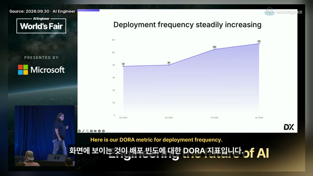 | [1:45](https://youtu.be/xRZHLI5SPWo?t=105) scene-change | organization. So here's our Dora metric for deployment frequency. Who's | slide, 제목 `Deployment frequency steadily increasing`, 수치 78(high, Q3 2025 deployment frequency), 80(high, Q4 2025 deployment frequency), 105(high, Q1 2026 deployment frequency), 114(high, Q2 2026 deployment frequency) | [ ] |
| 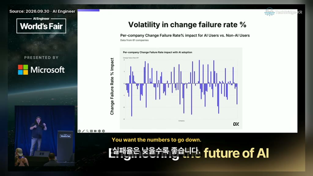 | [4:59](https://youtu.be/xRZHLI5SPWo?t=299) transcript-cue | terms of your change failure rate. You want to go down. You want to be on the | slide, 제목 `Volatility in change failure rate %`, 수치 61(high, companies (data from)) | [ ] |
| 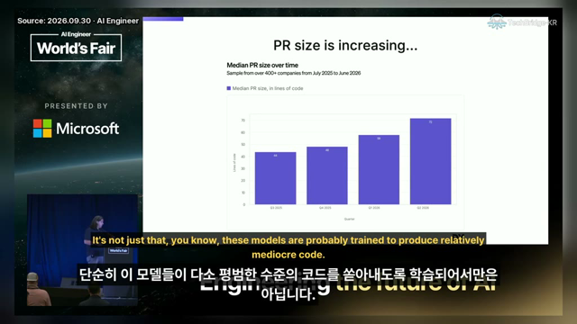 | [7:08](https://youtu.be/xRZHLI5SPWo?t=428) scene-change | of reasons for this. It's not just, you know, the likelihood that the way that these models work | slide, 제목 `PR size is increasing...`, 수치 44(high, Median PR size Q3 2025), 48(high, Median PR size Q4 2025), 58(high, Median PR size Q1 2026), 72(high, Median PR size Q2 2026) | [x] 400+(표본 기업 수) |
| 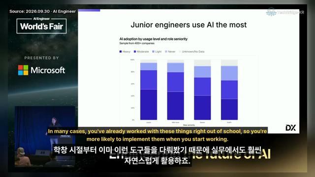 | [8:55](https://youtu.be/xRZHLI5SPWo?t=535) scene-change | unlearn when you're coming into the industry, right? In many, many cases, you've already been working with | slide, 제목 `Junior engineers use AI the most`, 수치 400+(high, Sample from) | [ ] |
| 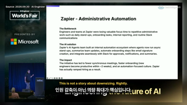 | [17:27](https://youtu.be/xRZHLI5SPWo?t=1047) transcript-cue | Increased innovative capacity story. This is not a headcount replacement story. Fair. They're automating about 3,000 of  | slide, 제목 `Zapier - Administrative Automation`, 수치 ~2(high, new engineers become productive within) | [ ] |

### -TeOEuplMrQ

| 썸네일 | 시각·이유 | 발화(spoken_text) | 판독 | 놓친 수치 있음 |
|---|---|---|---|---|
|  | [1:08](https://youtu.be/-TeOEuplMrQ?t=68) transcript-cue | Some folks are trying that too. | slide, 제목 `What are we talking about today?`, 수치  | [ ] |
| 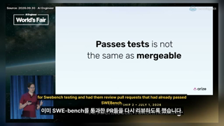 | [6:54](https://youtu.be/-TeOEuplMrQ?t=415) transcript-cue | And they got them to look at PRs that had already passed Sweebench's greater. | slide, 제목 `Passes tests is not the same as mergeable`, 수치  | [ ] |
| 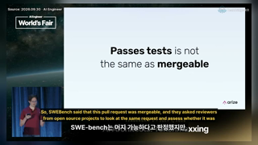 | [7:01](https://youtu.be/-TeOEuplMrQ?t=421) transcript-cue | So Sweebench said, this pull request is good enough to merge. | slide, 제목 `Passes tests is not the same as mergeable`, 수치  | [ ] |
| 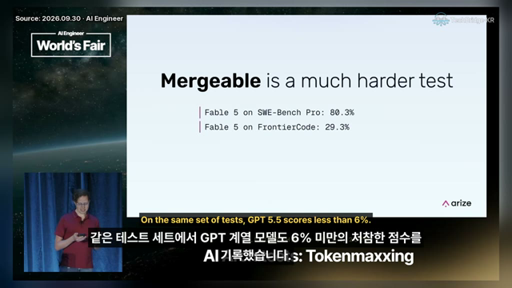 | [8:47](https://youtu.be/-TeOEuplMrQ?t=527) scene-change | And this isn't one model having a bad day. On the same set of tests, GPT 5.5 scores under 6%. | slide, 제목 `Mergeable is a much harder test`, 수치 80.3%(high, Fable 5 on SWE-Bench Pro), 29.3%(high, Fable 5 on FrontierCode) | [ ] |
| 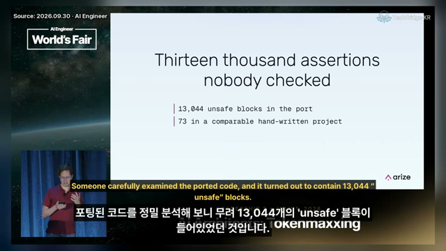 | [16:31](https://youtu.be/-TeOEuplMrQ?t=991) scene-change | Somebody looked carefully at the ported code, and it has 13,044 unsafe blocks. | slide, 제목 `Thirteen thousand assertions nobody checked`, 수치 13,044(high, unsafe blocks in the port), 73(high, in a comparable hand-written project) | [ ] |

### oeL0uP-NO-U

| 썸네일 | 시각·이유 | 발화(spoken_text) | 판독 | 놓친 수치 있음 |
|---|---|---|---|---|
| 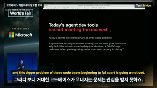 | [5:25](https://youtu.be/oeL0uP-NO-U?t=325) scene-change | And this bigger problem of these code bases beginning to fall apart is going unnoticed. | slide, 제목 `Today's agent dev tools are not meeting the moment`, 수치 50,000(high, repo codebase) | [ ] |
| 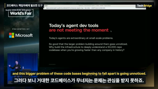 | [5:25](https://youtu.be/oeL0uP-NO-U?t=326) transcript-cue | And this bigger problem of these code bases beginning to fall apart is going unnoticed. | slide, 제목 `Today's agent dev tools are not meeting the moment`, 수치 50,000(high, repo codebase) | [ ] |
| 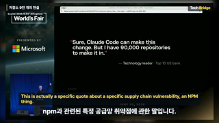 | [6:31](https://youtu.be/oeL0uP-NO-U?t=392) scene-change | This is actually a specific quote about a specific supply chain vulnerability, an NPM thing. | slide, 제목 ``, 수치 90,000(high, repositories) | [ ] |
| 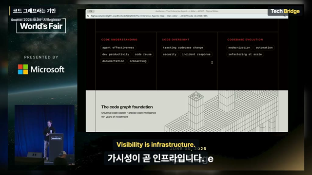 | [8:58](https://youtu.be/oeL0uP-NO-U?t=538) scene-change | And we actually built a lot on top of this, right? | slide, 제목 `The code graph foundation`, 수치 10+(high, of investment) | [ ] |
| 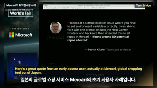 | [10:05](https://youtu.be/oeL0uP-NO-U?t=605) scene-change | Actually, Mercari, a global shopping tool out of Japan. | slide, 제목 ``, 수치 80(high, potential repos affected) | [ ] |

### 31XD1O74pks

| 썸네일 | 시각·이유 | 발화(spoken_text) | 판독 | 놓친 수치 있음 |
|---|---|---|---|---|
| 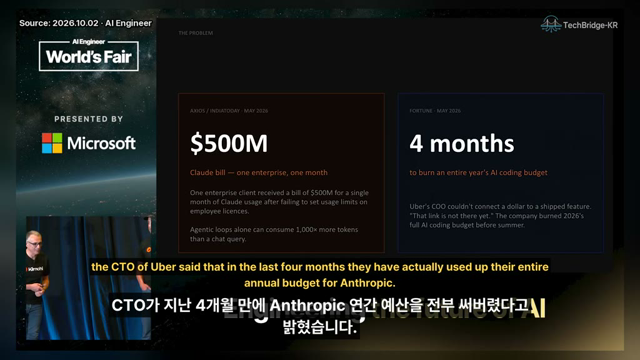 | [1:03](https://youtu.be/31XD1O74pks?t=63) scene-change | he actually used the entire budget of Anthropic for the entire year. | slide, 제목 `THE PROBLEM`, 수치 $500M(high, Claude bill — one enterprise, one month), 1,000x(high, more tokens than a chat query), 4 months(high, to burn an entire year's AI coding budget) | [ ] |
| 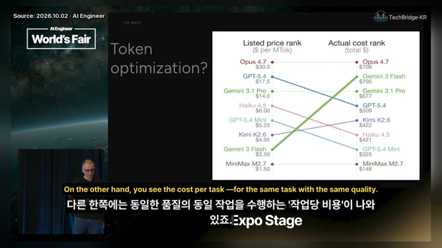 | [3:16](https://youtu.be/31XD1O74pks?t=197) scene-change | On the other side, you see the cost per task for the same task, | slide, 제목 `Token optimization?`, 수치 4.7(high, Opus (model version)), $30.0(high, Opus 4.7 listed price per MTok), 5.4(high, GPT-5.4 (model version)), $17.5(high, GPT-5.4 listed price per MTok), 3.1(high, Gemini 3.1 Pro (model version)), $14.0(high, Gemini 3.1 Pro listed price per MTok), 4.5(high, Haiku 4.5 (model version)), $6.00(high, Haiku 4.5 listed price per MTok), 5.4(high, GPT-5.4 Mini (model version)), $5.25(high, GPT-5.4 Mini listed price per MTok), K2.6(high, Kimi K2.6 (model version)), $4.95(high, Kimi K2.6 listed price per MTok), 3(high, Gemini 3 Flash (model version)), $3.50(high, Gemini 3 Flash listed price per MTok), M2.7(high, MiniMax M2.7 (model version)), $1.50(high, MiniMax M2.7 listed price per MTok), $708(high, Opus 4.7 actual total cost), $705(high, Gemini 3 Flash actual total cost), $677(high, Gemini 3.1 Pro actual total cost), $509(high, GPT-5.4 actual total cost), $422(high, Kimi K2.6 actual total cost), $421(high, Haiku 4.5 actual total cost), $325(high, GPT-5.4 Mini actual total cost), $148(high, MiniMax M2.7 actual total cost) | [ ] |
| 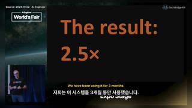 | [4:40](https://youtu.be/31XD1O74pks?t=280) scene-change | We've been using it for three months. | slide, 제목 `The result:`, 수치 2.5×(high, The result) | [ ] |
| 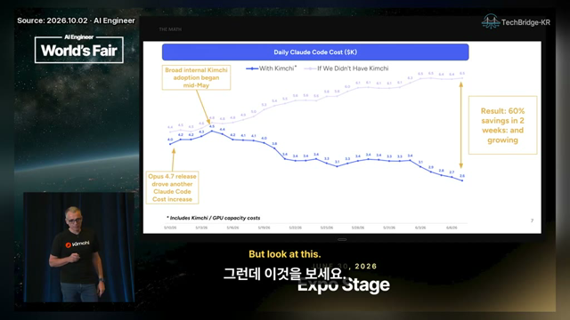 | [5:05](https://youtu.be/31XD1O74pks?t=306) transcript-cue | Same outcome. | slide, 제목 `Daily Claude Code Cost ($K)`, 수치 60%(high, savings in 2 weeks) | [x] 일일 비용 값(With Kimchi 약 4.0→2.6, 없을 때 4.4→6.5) |
| 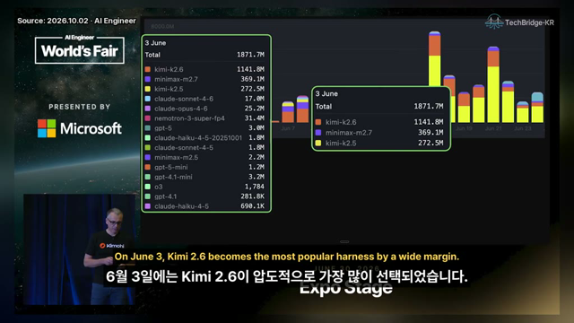 | [6:15](https://youtu.be/31XD1O74pks?t=375) scene-change | The 3rd of June, Kimi 2.6 is winning by far the most popular | slide, 제목 `3 June`, 수치 1871.7M(high, Total), 1141.8M(high, kimi-k2.6), 369.1M(high, minimax-m2.7), 272.5M(high, kimi-k2.5), 17.0M(high, claude-sonnet-4-6), 25.2M(high, claude-opus-4-6), 31.4M(high, nemotron-3-super-fp4), 3.0M(high, gpt-5), 1.8M(high, claude-haiku-4-5-20251001), 1.8M(high, claude-sonnet-4-5), 2.2M(high, minimax-m2.5), 1.2M(high, gpt-5-mini), 3.2M(high, gpt-4.1-mini), 1,784(high, o3), 281.8K(high, gpt-4.1), 690.1K(high, claude-haiku-4-6) | [ ] |

### yNPS1Z64wQM

| 썸네일 | 시각·이유 | 발화(spoken_text) | 판독 | 놓친 수치 있음 |
|---|---|---|---|---|
| 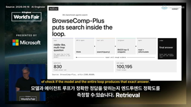 | [5:46](https://youtu.be/yNPS1Z64wQM?t=346) transcript-cue | produces that exact answer. | slide, 제목 `BrowseComp-Plus puts search inside the loop.`, 수치 830(high, questions fixed answer set), 100,195(high, web pages fixed corpus) | [ ] |
| 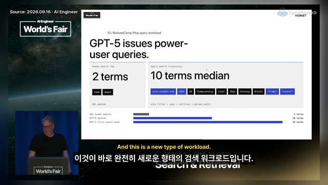 | [9:36](https://youtu.be/yNPS1Z64wQM?t=576) transcript-cue | And this is a new type of workload. | slide, 제목 `GPT-5 issues power-user queries.`, 수치 10(high, BrowseComp-Plus query workload), 2 terms(high, human search log), 10 terms median(high, agent search trajectory), 2 terms(high, AOL human median), 18 terms(high, GPT-5 median), 19 terms(high, GPT-5 first query mean) | [ ] |
| 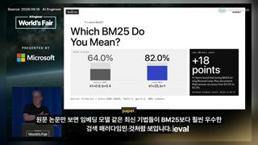 | [10:13](https://youtu.be/yNPS1Z64wQM?t=613) transcript-cue | than BM25, if you look at the original paper. | slide, 제목 `Which BM25 Do You Mean?`, 수치 64.0%(high, answer accuracy (Default BM25)), 82.0%(high, answer accuracy (Tuned BM25)), +18(high, same 100-query subset), 84.6%(high, Surfaced evidence recall), 95.7%(high, Surfaced evidence recall) | [x] 100-query subset, k1=0.9·b=0.4 / k1=25·b=1 |
| 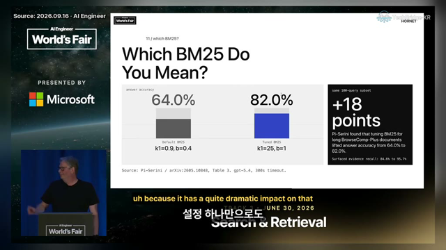 | [10:34](https://youtu.be/yNPS1Z64wQM?t=635) transcript-cue | on the overall accuracy. | slide, 제목 `Which BM25 Do You Mean?`, 수치 64.0%(high, answer accuracy (Default BM25)), 82.0%(high, answer accuracy (Tuned BM25)), +18(high, same 100-query subset), 64.0%(high, answer accuracy from), 82.0%(high, answer accuracy to), 84.6%(high, Surfaced evidence recall), 95.7%(high, Surfaced evidence recall) | [x] 100-query subset, k1·b 값 |
|  | [14:37](https://youtu.be/yNPS1Z64wQM?t=878) transcript-cue | and a whole editing search experience. | slide, 제목 `BM25 + grep Is All You Need`, 수치 61%(high, DCI read + grep), 45%(high, Qwen3 retrieval agent), 73.3%(high, DR-DCI + reset dynamic workspace expansion on BrowseComp-Plus) | [ ] |

### S-bRN-avZ4Q

| 썸네일 | 시각·이유 | 발화(spoken_text) | 판독 | 놓친 수치 있음 |
|---|---|---|---|---|
| 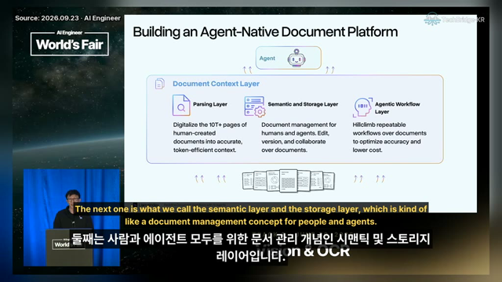 | [7:01](https://youtu.be/S-bRN-avZ4Q?t=422) scene-change | The next is actually what we call the semantic and storage layer, | slide, 제목 `Building an Agent-Native Document Platform`, 수치 10T+(high, pages of human-created documents) | [ ] |
| 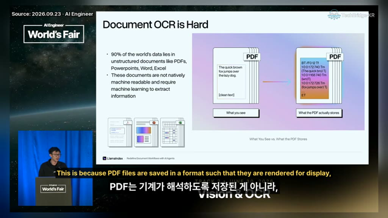 | [8:45](https://youtu.be/S-bRN-avZ4Q?t=525) scene-change | That's because the way PDFs are actually stored as a format is it's rendered for kind of like display purposes, | slide, 제목 `Document OCR is Hard`, 수치 90%(high, of the world's data lies in unstructured documents) | [ ] |
| 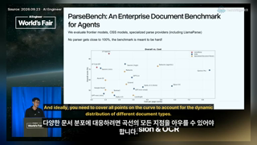 | [14:32](https://youtu.be/S-bRN-avZ4Q?t=873) transcript-cue | various types of documents out there. | slide, 제목 `ParseBench: An Enterprise Document Benchmark for Agents`, 수치 100%(high, parser score (no parser gets close to)) | 판단 불가(320px, 그래프 라벨을 읽을 수 없음) |
| 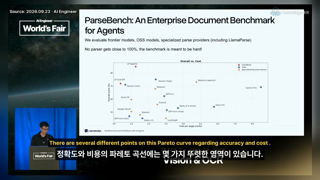 | [14:51](https://youtu.be/S-bRN-avZ4Q?t=892) transcript-cue | to make sure that you're able to process, unlock the vast troves of enterprise context out there. | slide, 제목 `ParseBench: An Enterprise Document Benchmark for Agents`, 수치 100%(high, parser score (no parser gets close to)), 4.5(high, Haku 4.5 (think)), 4.6(high, Opus 4.6), 4.5(high, Haku 4.5) | 판단 불가(320px, 그래프 라벨을 읽을 수 없음) |
| 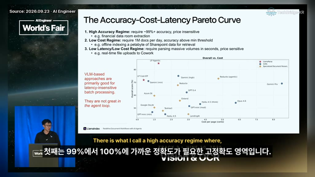 | [15:00](https://youtu.be/S-bRN-avZ4Q?t=900) scene-change | There's what I call like the high accuracy regime, where like, you know, some institutions basically need like 99 to alm | slide, 제목 `The Accuracy-Cost-Latency Pareto Curve`, 수치 99%(high, High Accuracy Regime accuracy), 1M(high, Low Cost Regime volume) | [ ] |

### eTtZlAPA9H4

| 썸네일 | 시각·이유 | 발화(spoken_text) | 판독 | 놓친 수치 있음 |
|---|---|---|---|---|
|  | [3:21](https://youtu.be/eTtZlAPA9H4?t=201) transcript-cue | So now that we have this and we understand the basics, | demo, 제목 ``, 수치  | [ ] |
| 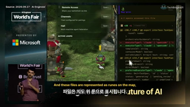 | [4:05](https://youtu.be/eTtZlAPA9H4?t=245) transcript-cue | And these files are represented as rooms on the map, | demo, 제목 ``, 수치  | [ ] |
|  | [8:04](https://youtu.be/eTtZlAPA9H4?t=484) transcript-cue | if you look at what a team does, for example, | slide, 제목 `Engineering the future of AI`, 수치  | [ ] |
|  | [9:22](https://youtu.be/eTtZlAPA9H4?t=563) transcript-cue | I can use Git, but I'm not really bound to something. | demo, 제목 ``, 수치  | [ ] |
|  | [9:33](https://youtu.be/eTtZlAPA9H4?t=573) transcript-cue | but also between agents. | demo, 제목 ``, 수치  | [ ] |
## 4. slide_only_facts 전체 (발화에 없고 화면에만 있는 수치)

판독 수치 정확도 문턱값: 이 표에서 '화면에 있음' 비율 90% 이상. 문턱값은 '화면에 있음' 칸으로만 계산한다.

'쓸 수 없음' 기준: 화면에는 있지만 브리핑 수치가 아님(모델 버전 번호, 데모·터미널 UI 값, 도식 속 예시 값, 슬라이드 번호 등).

> labeler: opus-5.5(잠정). 설계 세션의 2차 채점이며 사람 라벨이 아니다. 기준은 PR #7 리뷰 댓글 부록 B.

| 영상 | 초 | 수치 | 단위 | 무엇 | 확신도 | 근거 id | 썸네일 | 화면에 있음 | 쓸 수 없음 |
|---|---|---|---|---|---|---|---|---|---|
| xRZHLI5SPWo | [105](https://youtu.be/xRZHLI5SPWo?t=105) | 78 |  | Q3 2025 deployment frequency | high | `vd:15@105` |  | [x] | [ ] |
| xRZHLI5SPWo | [105](https://youtu.be/xRZHLI5SPWo?t=105) | 80 |  | Q4 2025 deployment frequency | high | `vd:15@105` |  | [x] | [ ] |
| xRZHLI5SPWo | [105](https://youtu.be/xRZHLI5SPWo?t=105) | 105 |  | Q1 2026 deployment frequency | high | `vd:15@105` |  | [x] | [ ] |
| xRZHLI5SPWo | [105](https://youtu.be/xRZHLI5SPWo?t=105) | 114 |  | Q2 2026 deployment frequency | high | `vd:15@105` |  | [x] | [ ] |
| xRZHLI5SPWo | [299](https://youtu.be/xRZHLI5SPWo?t=299) | 61 |  | companies (data from) | high | `vd:15@299` |  | [x] | [ ] |
| xRZHLI5SPWo | [428](https://youtu.be/xRZHLI5SPWo?t=428) | 48 | lines of code | Median PR size Q4 2025 | high | `vd:15@428` |  | [x] | [ ] |
| xRZHLI5SPWo | [428](https://youtu.be/xRZHLI5SPWo?t=428) | 58 | lines of code | Median PR size Q1 2026 | high | `vd:15@428` |  | [x] | [ ] |
| xRZHLI5SPWo | [535](https://youtu.be/xRZHLI5SPWo?t=535) | 400+ | companies | Sample from | high | `vd:15@535` |  | [x] | [ ] |
| xRZHLI5SPWo | [833](https://youtu.be/xRZHLI5SPWo?t=833) | 336 |  | Incomplete | high | `vd:15@833` | 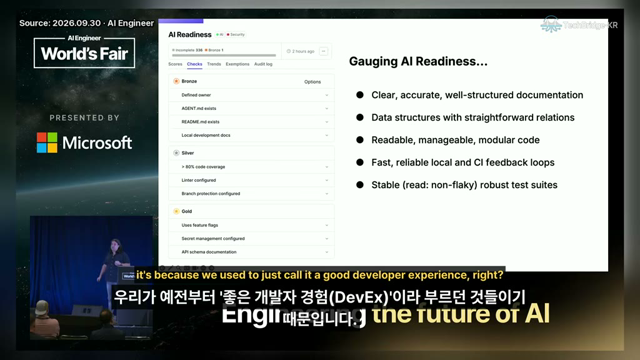 | [x] | [x] UI |
| xRZHLI5SPWo | [833](https://youtu.be/xRZHLI5SPWo?t=833) | 2 | hours ago | time | high | `vd:15@833` |  | [x] | [x] UI |
| xRZHLI5SPWo | [833](https://youtu.be/xRZHLI5SPWo?t=833) | > 80% | % | code coverage | high | `vd:15@833` |  | [x] | [x] UI |
| xRZHLI5SPWo | [905](https://youtu.be/xRZHLI5SPWo?t=905) | 400+ |  | companies (random sample) | high | `vd:15@905` | 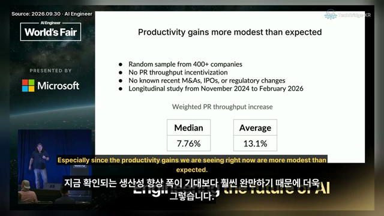 | [x] | [ ] |
| xRZHLI5SPWo | [905](https://youtu.be/xRZHLI5SPWo?t=905) | 7.76% | % | Median weighted PR throughput increase | high | `vd:15@905` |  | [x] | [ ] |
| xRZHLI5SPWo | [905](https://youtu.be/xRZHLI5SPWo?t=905) | 13.1% | % | Average weighted PR throughput increase | high | `vd:15@905` |  | [x] | [ ] |
| xRZHLI5SPWo | [966](https://youtu.be/xRZHLI5SPWo?t=966) | 2500 |  | Molding Max. per color | high | `vd:15@966` | 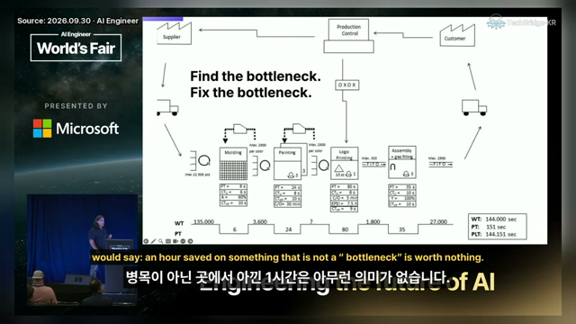 | 판단 불가(2500/2900 구분 불가) | [x] 도식 예시 |
| xRZHLI5SPWo | [966](https://youtu.be/xRZHLI5SPWo?t=966) | 12,500 | pcs | Molding max. | high | `vd:15@966` |  | [x] | [x] 도식 예시 |
| xRZHLI5SPWo | [966](https://youtu.be/xRZHLI5SPWo?t=966) | 6 s | s | Molding PT | high | `vd:15@966` |  | [x] | [x] 도식 예시 |
| xRZHLI5SPWo | [966](https://youtu.be/xRZHLI5SPWo?t=966) | 8 s | s | Molding CT | high | `vd:15@966` |  | 판단 불가(6 s로 보임) | [x] 도식 예시 |
| xRZHLI5SPWo | [966](https://youtu.be/xRZHLI5SPWo?t=966) | 60% | % | Molding A | high | `vd:15@966` |  | [x] | [x] 도식 예시 |
| xRZHLI5SPWo | [966](https://youtu.be/xRZHLI5SPWo?t=966) | 2500 |  | Painting Max. per color | high | `vd:15@966` |  | 판단 불가(2500/2900 구분 불가) | [x] 도식 예시 |
| xRZHLI5SPWo | [966](https://youtu.be/xRZHLI5SPWo?t=966) | 3 |  | Painting (count) | high | `vd:15@966` |  | [x] | [x] 도식 예시 |
| xRZHLI5SPWo | [966](https://youtu.be/xRZHLI5SPWo?t=966) | 24 s | s | Painting PT | high | `vd:15@966` |  | [x] | [x] 도식 예시 |
| xRZHLI5SPWo | [966](https://youtu.be/xRZHLI5SPWo?t=966) | 8 s | s | Painting CT | high | `vd:15@966` |  | [x] | [x] 도식 예시 |
| xRZHLI5SPWo | [966](https://youtu.be/xRZHLI5SPWo?t=966) | 30 min | min | Painting CTeff | high | `vd:15@966` |  | [ ] 화면에 없음(화면은 Painting C/O, CTeff는 10 s) | [ ] |
| xRZHLI5SPWo | [966](https://youtu.be/xRZHLI5SPWo?t=966) | 333 |  | Logo Printing Max. | high | `vd:15@966` |  | [x] | [x] 도식 예시 |
| xRZHLI5SPWo | [966](https://youtu.be/xRZHLI5SPWo?t=966) | 80 s | s | Logo Printing PT | high | `vd:15@966` |  | [x] | [x] 도식 예시 |
| xRZHLI5SPWo | [966](https://youtu.be/xRZHLI5SPWo?t=966) | 7.5 h | h | Logo Printing BPEL | high | `vd:15@966` |  | [x] | [x] 도식 예시 |
| xRZHLI5SPWo | [966](https://youtu.be/xRZHLI5SPWo?t=966) | 9 s | s | Logo Printing CTeff | high | `vd:15@966` |  | [x] | [x] 도식 예시 |
| xRZHLI5SPWo | [966](https://youtu.be/xRZHLI5SPWo?t=966) | 35 s | s | Assembly PT | high | `vd:15@966` |  | [x] | [x] 도식 예시 |
| xRZHLI5SPWo | [966](https://youtu.be/xRZHLI5SPWo?t=966) | 100% | % | Assembly A | high | `vd:15@966` |  | [x] | [x] 도식 예시 |
| xRZHLI5SPWo | [966](https://youtu.be/xRZHLI5SPWo?t=966) | 2500 |  | Assembly Max. | high | `vd:15@966` |  | 판단 불가(2500/2900 구분 불가) | [x] 도식 예시 |
| xRZHLI5SPWo | [966](https://youtu.be/xRZHLI5SPWo?t=966) | 3 |  | Assembly (count) | high | `vd:15@966` |  | [x] | [x] 도식 예시 |
| xRZHLI5SPWo | [966](https://youtu.be/xRZHLI5SPWo?t=966) | 135,000 |  | WT (first) | high | `vd:15@966` |  | [x] | [x] 도식 예시 |
| xRZHLI5SPWo | [966](https://youtu.be/xRZHLI5SPWo?t=966) | 3,600 |  | WT | high | `vd:15@966` |  | [x] | [x] 도식 예시 |
| xRZHLI5SPWo | [966](https://youtu.be/xRZHLI5SPWo?t=966) | 1,800 |  | WT | high | `vd:15@966` |  | [x] | [x] 도식 예시 |
| xRZHLI5SPWo | [966](https://youtu.be/xRZHLI5SPWo?t=966) | 27,000 |  | WT (last) | high | `vd:15@966` |  | [x] | [x] 도식 예시 |
| xRZHLI5SPWo | [966](https://youtu.be/xRZHLI5SPWo?t=966) | 6 |  | WT (interval) | high | `vd:15@966` |  | [x] | [x] 도식 예시 |
| xRZHLI5SPWo | [966](https://youtu.be/xRZHLI5SPWo?t=966) | 24 |  | WT (interval) | high | `vd:15@966` |  | [x] | [x] 도식 예시 |
| xRZHLI5SPWo | [966](https://youtu.be/xRZHLI5SPWo?t=966) | 80 |  | WT (interval) | high | `vd:15@966` |  | [x] | [x] 도식 예시 |
| xRZHLI5SPWo | [966](https://youtu.be/xRZHLI5SPWo?t=966) | 35 |  | WT (interval) | high | `vd:15@966` |  | [x] | [x] 도식 예시 |
| xRZHLI5SPWo | [966](https://youtu.be/xRZHLI5SPWo?t=966) | 144,000 | sec | WT | high | `vd:15@966` |  | [x] | [x] 도식 예시 |
| xRZHLI5SPWo | [966](https://youtu.be/xRZHLI5SPWo?t=966) | 151 | sec | PT | high | `vd:15@966` |  | [x] | [x] 도식 예시 |
| xRZHLI5SPWo | [966](https://youtu.be/xRZHLI5SPWo?t=966) | 144,151 | sec | PLT | high | `vd:15@966` |  | [x] | [x] 도식 예시 |
| xRZHLI5SPWo | [1075](https://youtu.be/xRZHLI5SPWo?t=1075) | 90% | % | of all incidents at Spotify | high | `vd:15@1075` | 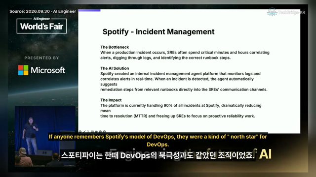 | [x] | [ ] |
| -TeOEuplMrQ | [527](https://youtu.be/-TeOEuplMrQ?t=527) | 80.3% | % | Fable 5 on SWE-Bench Pro | high | `vd:13@527` |  | [x] | [ ] |
| -TeOEuplMrQ | [527](https://youtu.be/-TeOEuplMrQ?t=527) | 29.3% | % | Fable 5 on FrontierCode | high | `vd:13@527` |  | [x] | [ ] |
| -TeOEuplMrQ | [991](https://youtu.be/-TeOEuplMrQ?t=991) | 73 |  | in a comparable hand-written project | high | `vd:13@991` |  | [x] | [ ] |
| oeL0uP-NO-U | [538](https://youtu.be/oeL0uP-NO-U?t=538) | 10+ | years | of investment | high | `vd:6@538` |  | [x] | [ ] |
| 31XD1O74pks | [63](https://youtu.be/31XD1O74pks?t=63) | 1,000x | x | more tokens than a chat query | high | `vd:2@63` |  | [x] | [ ] |
| 31XD1O74pks | [197](https://youtu.be/31XD1O74pks?t=197) | 4.7 |  | Opus (model version) | high | `vd:2@197` |  | [x] | [x] 버전 |
| 31XD1O74pks | [197](https://youtu.be/31XD1O74pks?t=197) | $30.0 | $ | Opus 4.7 listed price per MTok | high | `vd:2@197` |  | [x] | [ ] |
| 31XD1O74pks | [197](https://youtu.be/31XD1O74pks?t=197) | $17.5 | $ | GPT-5.4 listed price per MTok | high | `vd:2@197` |  | [x] | [ ] |
| 31XD1O74pks | [197](https://youtu.be/31XD1O74pks?t=197) | $14.0 | $ | Gemini 3.1 Pro listed price per MTok | high | `vd:2@197` |  | [x] | [ ] |
| 31XD1O74pks | [197](https://youtu.be/31XD1O74pks?t=197) | $6.00 | $ | Haiku 4.5 listed price per MTok | high | `vd:2@197` |  | [x] | [ ] |
| 31XD1O74pks | [197](https://youtu.be/31XD1O74pks?t=197) | $5.25 | $ | GPT-5.4 Mini listed price per MTok | high | `vd:2@197` |  | [x] | [ ] |
| 31XD1O74pks | [197](https://youtu.be/31XD1O74pks?t=197) | $4.95 | $ | Kimi K2.6 listed price per MTok | high | `vd:2@197` |  | [x] | [ ] |
| 31XD1O74pks | [197](https://youtu.be/31XD1O74pks?t=197) | $1.50 | $ | MiniMax M2.7 listed price per MTok | high | `vd:2@197` |  | [x] | [ ] |
| 31XD1O74pks | [197](https://youtu.be/31XD1O74pks?t=197) | $708 | $ | Opus 4.7 actual total cost | high | `vd:2@197` |  | [x] | [ ] |
| 31XD1O74pks | [197](https://youtu.be/31XD1O74pks?t=197) | $705 | $ | Gemini 3 Flash actual total cost | high | `vd:2@197` |  | [x] | [ ] |
| 31XD1O74pks | [197](https://youtu.be/31XD1O74pks?t=197) | $677 | $ | Gemini 3.1 Pro actual total cost | high | `vd:2@197` |  | [x] | [ ] |
| 31XD1O74pks | [197](https://youtu.be/31XD1O74pks?t=197) | $509 | $ | GPT-5.4 actual total cost | high | `vd:2@197` |  | [x] | [ ] |
| 31XD1O74pks | [197](https://youtu.be/31XD1O74pks?t=197) | $422 | $ | Kimi K2.6 actual total cost | high | `vd:2@197` |  | [x] | [ ] |
| 31XD1O74pks | [197](https://youtu.be/31XD1O74pks?t=197) | $421 | $ | Haiku 4.5 actual total cost | high | `vd:2@197` |  | [x] | [ ] |
| 31XD1O74pks | [197](https://youtu.be/31XD1O74pks?t=197) | $325 | $ | GPT-5.4 Mini actual total cost | high | `vd:2@197` |  | [x] | [ ] |
| 31XD1O74pks | [197](https://youtu.be/31XD1O74pks?t=197) | $148 | $ | MiniMax M2.7 actual total cost | high | `vd:2@197` |  | [x] | [ ] |
| 31XD1O74pks | [306](https://youtu.be/31XD1O74pks?t=306) | 60% | % | savings in 2 weeks | high | `vd:2@306` |  | [x] | [ ] |
| 31XD1O74pks | [375](https://youtu.be/31XD1O74pks?t=375) | 1871.7M | M | Total | high | `vd:2@375` |  | [x] | [ ] |
| 31XD1O74pks | [375](https://youtu.be/31XD1O74pks?t=375) | 1141.8M | M | kimi-k2.6 | high | `vd:2@375` |  | [x] | [ ] |
| 31XD1O74pks | [375](https://youtu.be/31XD1O74pks?t=375) | 369.1M | M | minimax-m2.7 | high | `vd:2@375` |  | [x] | [ ] |
| 31XD1O74pks | [375](https://youtu.be/31XD1O74pks?t=375) | 272.5M | M | kimi-k2.5 | high | `vd:2@375` |  | [x] | [ ] |
| 31XD1O74pks | [375](https://youtu.be/31XD1O74pks?t=375) | 17.0M | M | claude-sonnet-4-6 | high | `vd:2@375` |  | [x] | [x] UI(대시보드 작은 행) |
| 31XD1O74pks | [375](https://youtu.be/31XD1O74pks?t=375) | 25.2M | M | claude-opus-4-6 | high | `vd:2@375` |  | [x] | [x] UI(대시보드 작은 행) |
| 31XD1O74pks | [375](https://youtu.be/31XD1O74pks?t=375) | 31.4M | M | nemotron-3-super-fp4 | high | `vd:2@375` |  | [x] | [x] UI(대시보드 작은 행) |
| 31XD1O74pks | [375](https://youtu.be/31XD1O74pks?t=375) | 3.0M | M | gpt-5 | high | `vd:2@375` |  | [x] | [x] UI(대시보드 작은 행) |
| 31XD1O74pks | [375](https://youtu.be/31XD1O74pks?t=375) | 1.8M | M | claude-haiku-4-5-20251001 | high | `vd:2@375` |  | [x] | [x] UI(대시보드 작은 행) |
| 31XD1O74pks | [375](https://youtu.be/31XD1O74pks?t=375) | 1.8M | M | claude-sonnet-4-5 | high | `vd:2@375` |  | [x] | [x] UI(대시보드 작은 행) |
| 31XD1O74pks | [375](https://youtu.be/31XD1O74pks?t=375) | 2.2M | M | minimax-m2.5 | high | `vd:2@375` |  | [x] | [x] UI(대시보드 작은 행) |
| 31XD1O74pks | [375](https://youtu.be/31XD1O74pks?t=375) | 1.2M | M | gpt-5-mini | high | `vd:2@375` |  | [x] | [x] UI(대시보드 작은 행) |
| 31XD1O74pks | [375](https://youtu.be/31XD1O74pks?t=375) | 3.2M | M | gpt-4.1-mini | high | `vd:2@375` |  | [x] | [x] UI(대시보드 작은 행) |
| 31XD1O74pks | [375](https://youtu.be/31XD1O74pks?t=375) | 1,784 |  | o3 | high | `vd:2@375` |  | [x] | [x] UI(대시보드 작은 행) |
| 31XD1O74pks | [375](https://youtu.be/31XD1O74pks?t=375) | 281.8K | K | gpt-4.1 | high | `vd:2@375` |  | [x] | [x] UI(대시보드 작은 행) |
| 31XD1O74pks | [375](https://youtu.be/31XD1O74pks?t=375) | 690.1K | K | claude-haiku-4-6 | high | `vd:2@375` |  | [x] | [x] UI(대시보드 작은 행) |
| 31XD1O74pks | [488](https://youtu.be/31XD1O74pks?t=488) | 42 | lines | src/store/todo.ts | low | `vd:2@488` | 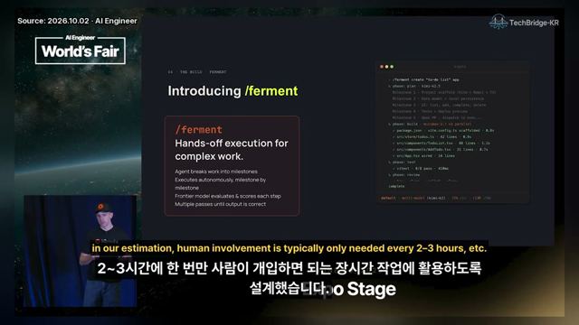 | [x] | [x] UI(터미널 데모) |
| 31XD1O74pks | [488](https://youtu.be/31XD1O74pks?t=488) | 88 | lines | src/components/TodoList.tsx | low | `vd:2@488` |  | 판단 불가 | [x] UI(터미널 데모) |
| 31XD1O74pks | [488](https://youtu.be/31XD1O74pks?t=488) | 31 | lines | src/components/AddTodo.tsx | low | `vd:2@488` |  | [x] | [x] UI(터미널 데모) |
| 31XD1O74pks | [488](https://youtu.be/31XD1O74pks?t=488) | 14 | lines | src/App.tsx wired | low | `vd:2@488` |  | [x] | [x] UI(터미널 데모) |
| 31XD1O74pks | [488](https://youtu.be/31XD1O74pks?t=488) | 8/8 | pass | vitest | low | `vd:2@488` |  | [x] | [x] UI(터미널 데모) |
| 31XD1O74pks | [488](https://youtu.be/31XD1O74pks?t=488) | 480ms | ms | vitest | low | `vd:2@488` |  | 판단 불가 | [x] UI(터미널 데모) |
| 31XD1O74pks | [488](https://youtu.be/31XD1O74pks?t=488) | 72% | % | multi-model (kimi-k2) | low | `vd:2@488` |  | 판단 불가 | [x] UI(터미널 데모) |
| 31XD1O74pks | [488](https://youtu.be/31XD1O74pks?t=488) | +13M |  | multi-model (kimi-k2) | low | `vd:2@488` |  | 판단 불가 | [x] UI(터미널 데모) |
| 31XD1O74pks | [488](https://youtu.be/31XD1O74pks?t=488) | 7/8 |  | multi-model (kimi-k2) | low | `vd:2@488` |  | 판단 불가 | [x] UI(터미널 데모) |
| yNPS1Z64wQM | [138](https://youtu.be/yNPS1Z64wQM?t=138) | 1990s |  | Okapi/TREC-era lexical ranking from the | high | `vd:43@138` | 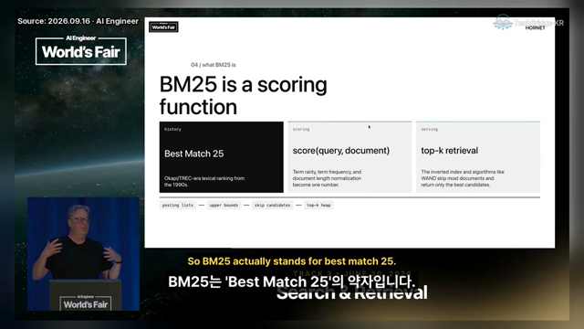 | [x] | [x] 기타(연대) |
| yNPS1Z64wQM | [280](https://youtu.be/yNPS1Z64wQM?t=280) | 100,195 |  | web pages fixed corpus | high | `vd:43@280` | 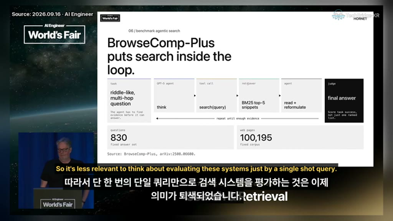 | [x] | [ ] |
| yNPS1Z64wQM | [397](https://youtu.be/yNPS1Z64wQM?t=397) | 55.9% | % | retriever A | high | `vd:43@397` | 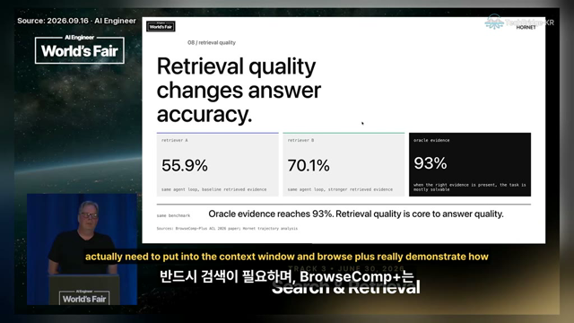 | [x] | [ ] |
| yNPS1Z64wQM | [397](https://youtu.be/yNPS1Z64wQM?t=397) | 70.1% | % | retriever B | high | `vd:43@397` |  | [x] | [ ] |
| yNPS1Z64wQM | [397](https://youtu.be/yNPS1Z64wQM?t=397) | 93% | % | oracle evidence | high | `vd:43@397` |  | [x] | [ ] |
| yNPS1Z64wQM | [397](https://youtu.be/yNPS1Z64wQM?t=397) | 93% | % | Oracle evidence reaches | high | `vd:43@397` |  | [x] | [ ] |
| yNPS1Z64wQM | [576](https://youtu.be/yNPS1Z64wQM?t=576) | 10 |  | BrowseComp-Plus query workload | high | `vd:43@576` |  | [x] | [x] 슬라이드 번호 |
| yNPS1Z64wQM | [576](https://youtu.be/yNPS1Z64wQM?t=576) | 10 terms median | terms | agent search trajectory | high | `vd:43@576` |  | [x] | [ ] |
| yNPS1Z64wQM | [576](https://youtu.be/yNPS1Z64wQM?t=576) | 18 terms | terms | GPT-5 median | high | `vd:43@576` |  | [ ] 화면에 없음(확대하면 10 terms, 확신 낮음) | [ ] |
| yNPS1Z64wQM | [576](https://youtu.be/yNPS1Z64wQM?t=576) | 19 terms | terms | GPT-5 first query mean | high | `vd:43@576` |  | [x] | [ ] |
| yNPS1Z64wQM | [592](https://youtu.be/yNPS1Z64wQM?t=592) | 64.0% | % | answer accuracy (Default BM25) | high | `vd:43@592` | 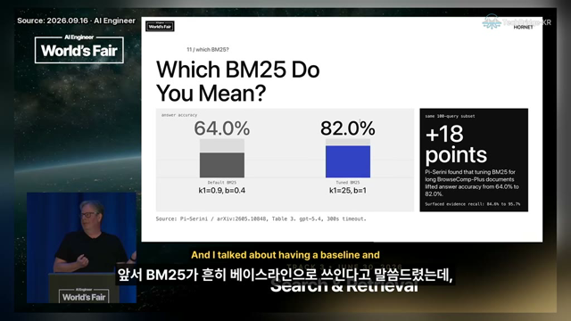 | [x] | [ ] |
| yNPS1Z64wQM | [592](https://youtu.be/yNPS1Z64wQM?t=592) | 82.0% | % | answer accuracy (Tuned BM25) | high | `vd:43@592` |  | [x] | [ ] |
| yNPS1Z64wQM | [592](https://youtu.be/yNPS1Z64wQM?t=592) | +18 | points | same 100-query subset | high | `vd:43@592` |  | [x] | [ ] |
| yNPS1Z64wQM | [592](https://youtu.be/yNPS1Z64wQM?t=592) | 84.6% | % | Surfaced evidence recall | high | `vd:43@592` |  | [x] | [ ] |
| yNPS1Z64wQM | [592](https://youtu.be/yNPS1Z64wQM?t=592) | 95.7% | % | Surfaced evidence recall | high | `vd:43@592` |  | [x] | [ ] |
| yNPS1Z64wQM | [635](https://youtu.be/yNPS1Z64wQM?t=635) | 64.0% | % | answer accuracy from | high | `vd:43@635` |  | [x] | [ ] |
| yNPS1Z64wQM | [635](https://youtu.be/yNPS1Z64wQM?t=635) | 82.0% | % | answer accuracy to | high | `vd:43@635` |  | [x] | [ ] |
| yNPS1Z64wQM | [747](https://youtu.be/yNPS1Z64wQM?t=747) | 61% | % | DCI read + grep | high | `vd:43@747` | 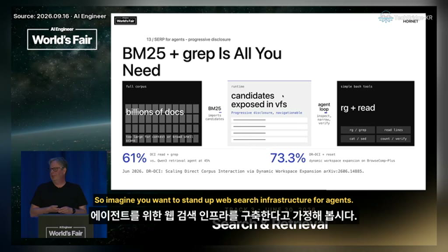 | [x] | [ ] |
| yNPS1Z64wQM | [747](https://youtu.be/yNPS1Z64wQM?t=747) | 45% | % | Qwen3 retrieval agent | high | `vd:43@747` |  | [x] | [ ] |
| yNPS1Z64wQM | [747](https://youtu.be/yNPS1Z64wQM?t=747) | 73.3% | % | DR-DCI + reset dynamic workspace expansion on BrowseComp-Plus | high | `vd:43@747` |  | [x] | [ ] |
| yNPS1Z64wQM | [897](https://youtu.be/yNPS1Z64wQM?t=897) | 14 |  | / evals | high | `vd:43@897` | 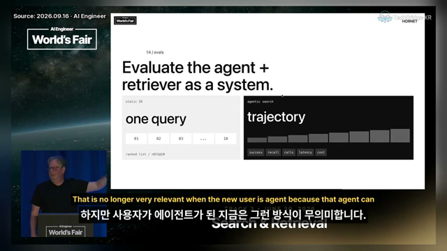 | [x] | [x] 슬라이드 번호 |
| yNPS1Z64wQM | [897](https://youtu.be/yNPS1Z64wQM?t=897) | 10 |  | static IR query count | high | `vd:43@897` |  | [x] | [x] 도식 예시 |
| yNPS1Z64wQM | [897](https://youtu.be/yNPS1Z64wQM?t=897) | 10 |  | nDCG@10 | high | `vd:43@897` |  | [x] | [x] 기타(지표 이름) |
| yNPS1Z64wQM | [933](https://youtu.be/yNPS1Z64wQM?t=933) | top-100 |  | ranking | high | `vd:43@933` | 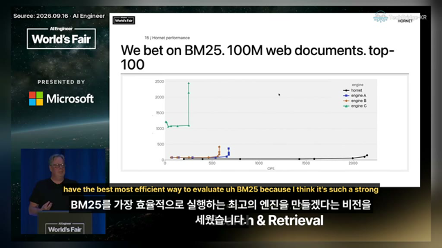 | [x] | [ ] |
| yNPS1Z64wQM | [1055](https://youtu.be/yNPS1Z64wQM?t=1055) | 1,509 |  | Following | high | `vd:43@1055` | 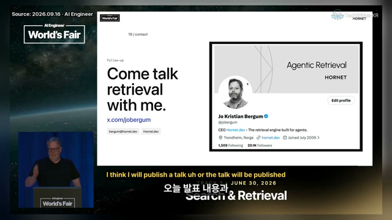 | [x] | [x] UI |
| yNPS1Z64wQM | [1055](https://youtu.be/yNPS1Z64wQM?t=1055) | 20.1K | K | Followers | high | `vd:43@1055` |  | [x] | [x] UI |
| S-bRN-avZ4Q | [422](https://youtu.be/S-bRN-avZ4Q?t=422) | 10T+ | T+ | pages of human-created documents | high | `vd:28@422` |  | [x] | [ ] |
| S-bRN-avZ4Q | [525](https://youtu.be/S-bRN-avZ4Q?t=525) | 90% | % | of the world's data lies in unstructured documents | high | `vd:28@525` |  | [x] | [ ] |
| S-bRN-avZ4Q | [900](https://youtu.be/S-bRN-avZ4Q?t=900) | 1M | docs per day | Low Cost Regime volume | high | `vd:28@900` |  | [x] | [ ] |
| S-bRN-avZ4Q | [992](https://youtu.be/S-bRN-avZ4Q?t=992) | 99%+ | % | High Accuracy Regime require | high | `vd:28@992` | 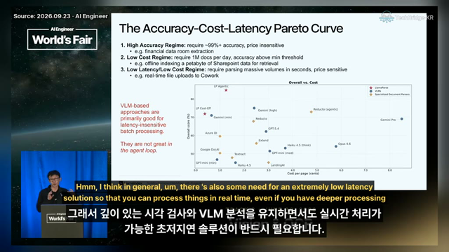 | [x] | [ ] |
| S-bRN-avZ4Q | [992](https://youtu.be/S-bRN-avZ4Q?t=992) | 1M | docs per day | Low Cost Regime require | high | `vd:28@992` |  | [x] | [ ] |
| S-bRN-avZ4Q | [1063](https://youtu.be/S-bRN-avZ4Q?t=1063) | 16 | page(s) | Paste 16 page(s) in 0.03s | high | `vd:28@1063` | 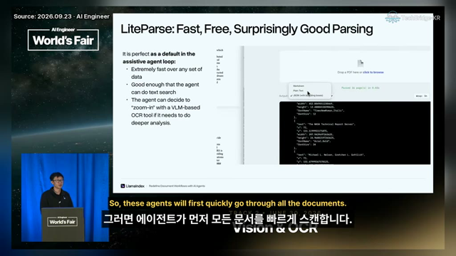 | 판단 불가(화면 문구는 Parsed … page(s)) | [x] UI |
| S-bRN-avZ4Q | [1063](https://youtu.be/S-bRN-avZ4Q?t=1063) | 0.03s | s | Paste 16 page(s) in 0.03s | high | `vd:28@1063` |  | 판단 불가(화면 문구는 Parsed … page(s)) | [x] UI |

124개. 썸네일 31장(폭 640px): 프레임 파일에서 31장, 영상에서 다시 뽑음 0장, 프레임 없음 0장.
### 확인 필요(check) 판독

| 영상 | 초 | 보이는 값 | 무엇 |
|---|---|---|---|
| - | - | - | - |

## 5. 표기 쌍(별칭 후보, V7)

keywords.yaml 반영은 설계 세션이 정한다.

| 영상 | 초 | 전사 표기 | 화면 표기 |
|---|---|---|---|
| xRZHLI5SPWo | 234 | METR study | METR |
| xRZHLI5SPWo | 1014 | Zapier | Zapier |
| xRZHLI5SPWo | 1075 | Spotify | Spotify |
| -TeOEuplMrQ | 527 | Sweebench | SWE-Bench Pro |
| -TeOEuplMrQ | 527 | Frontier Code | FrontierCode |
| oeL0uP-NO-U | 392 | cloud code | Claude Code |
| 31XD1O74pks | 138 | Kimshi | Kimchi |
| 31XD1O74pks | 280 | Kim C. Coding | Kimchi |
| 31XD1O74pks | 488 | Ferment | /ferment |
| 31XD1O74pks | 375 | Kimi 2.6 | kimi-k2.6 |
| 31XD1O74pks | 375 | Minimax 3 | minimax-m2.7 |
| 31XD1O74pks | 197 | Gemini 3 Flash | Gemini 3 Flash |
| 31XD1O74pks | 197 | Minimax 2.7 | MiniMax M2.7 |
| yNPS1Z64wQM | 55 | Argentic Search | agentic search |
| yNPS1Z64wQM | 280 | BrowseCom Plus | BrowseComp-Plus |
| yNPS1Z64wQM | 523 | Hornet.deb | hornet.dev |
| S-bRN-avZ4Q | 78 | Lama Index | LlamaIndex |
| S-bRN-avZ4Q | 780 | LamaParse | LlamaParse |
| S-bRN-avZ4Q | 1063 | LightParse | LiteParse |

## 6. whisper만 vs whisper+slides

같은 전사로 요약만 다시(슬라이드가 더한 것만 차이). `scripts/s4_compare.py`.

### -TeOEuplMrQ

| | whisper | whisper+slides |
|---|---|---|
| 포인트 수 | 6 | 6 |
| 슬라이드 전용 수치 | - | 3 |
| 표기 쌍 | 0 | 2 |

| whisper 포인트 | whisper+slides 포인트 |
|---|---|
| 자율 에이전트 사용 개발자의 코드 작성량 741% 증가, 소프트웨어 배포량 30% 증가 | 자율 에이전트 사용 개발자의 코드 작성량 741% 증가, 소프트웨어 배포량 30% 증가 |
| 리뷰어당 400~450줄 초과 시 결함 발견율 급감(Cisco 연구) | 리뷰어당 400~450줄 초과 시 결함 탐지율 급감(Cisco 연구) |
| 테스트 통과 PR의 실제 머지 적합률 약 50%(METR 연구) | 테스트 통과 PR의 실제 머지 가능 비율 약 50%(METR 연구) |
| Fable 5 모델의 Frontier Code 최난이도 점수 29%(Sweebench Pro 88% 대비) | Fable 5의 SWE-Bench Pro 80.3%와 FrontierCode 29.3% 점수 격차 |
| Bun의 Zig→Rust 포팅 코드 내 unsafe 블록 13,044개(동급 인간 코드 대비 약 74개) | Bun의 Zig→Rust 포팅 코드에 13,044개 unsafe 블록 포함(동급 수작업 코드 73개) |
| 프롬프트 인젝션 공격에 대한 자율 리뷰 에이전트 취약성(88% 성공률) | 인간 리뷰어의 역할이 코드 직접 검토에서 검증 시스템 설계로 상향 이동 |

### xRZHLI5SPWo

| | whisper | whisper+slides |
|---|---|---|
| 포인트 수 | 6 | 6 |
| 슬라이드 전용 수치 | - | 44 |
| 표기 쌍 | 0 | 3 |

| whisper 포인트 | whisper+slides 포인트 |
|---|---|
| 배포 빈도(DORA)는 전반적으로 증가했으나, 체감 속도 향상률은 약 4.5%로 제한적 | 배포 빈도(DORA) 지속 증가, Q3 2025 78에서 Q2 2026 114로 상승 |
| 변경 실패율(Change Failure Rate) 변동성 증가, 일부 기업은 벤치마크 대비 결함 50% 증가 | 체감 배포 속도 약 4.5% 증가로 정체, 실제 생산성 향상과 괴리 |
| 코드 유지보수성 인식은 4% 상승했으나, 변경 확신도(Change Confidence)는 6% 하락 | 변경 실패율(Change Failure Rate) 변동성 확대, 일부 기업 벤치마크 대비 50% 이상 결함 증가 |
| PR 평균 크기가 44줄에서 72줄로 증가하며 점진적 배포(Incremental Delivery) 인식 10% 하락 | PR 크기 급증(평균 44줄→72줄), 코드 유지보수성 체감 4% 상승 대비 배포 확신도 6% 하락 |
| 주니어 엔지니어의 AI 사용 빈도와 토큰 소모량이 높으나, 시니어와 시간 절감 효과는 유사 | AI 도입 후 PR 처리량 중위수 7.76%, 평균 13.1% 증가로 기대 대비 낮은 생산성 향상 |
| AI 도입 후 속도 향상 중앙값 7.7%로 기대 이하, 병목은 코드 생성이 아닌 전체 가치 흐름 | Zapier, Spotify 등 에이전트 도입으로 병목 해결 및 운영 효율화 사례 |

## 7. 재현 명령

```bash
uv sync --extra video
TRENDSIT_SPEC=S4 uv run python -m trendsit collect --source techbridge --since 2026-09-01
TRENDSIT_SPEC=S4 uv run --extra video python -m trendsit video run --queue reports/S4_video/queue_gateB.json
TRENDSIT_SPEC=S4 uv run --extra video python scripts/s4_compare.py xRZHLI5SPWo -TeOEuplMrQ
uv run --extra video python scripts/s4_eval_fixtures.py reports/S4_video/queue_gateB.json
TRENDSIT_SPEC=S4 uv run python -m trendsit eval video_summary
uv run --extra video python scripts/s4_artifacts.py reports/S4_video/queue_gateB.json
uv run --extra video python scripts/s4_label_sheets.py reports/S4_video/queue_gateB.json
```
